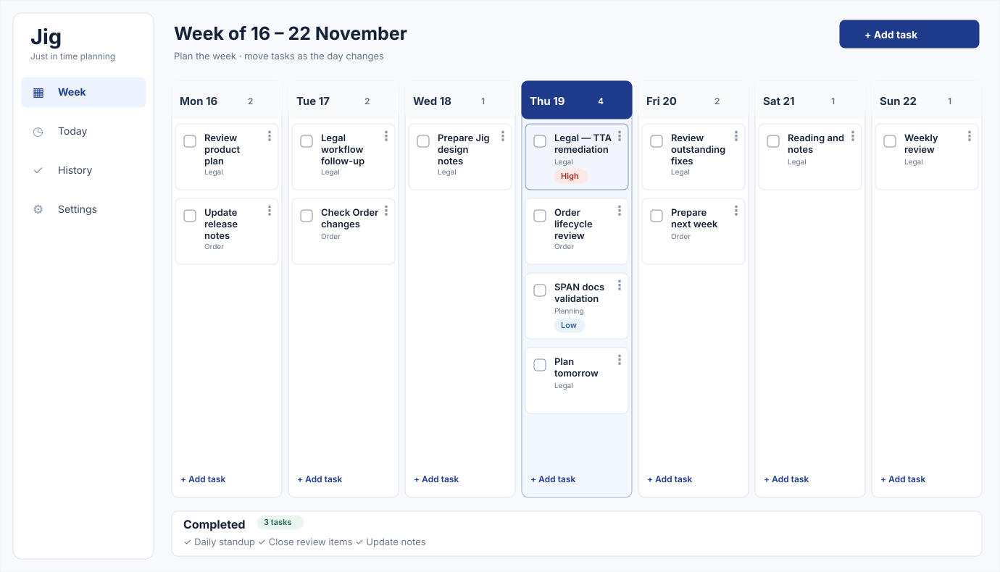
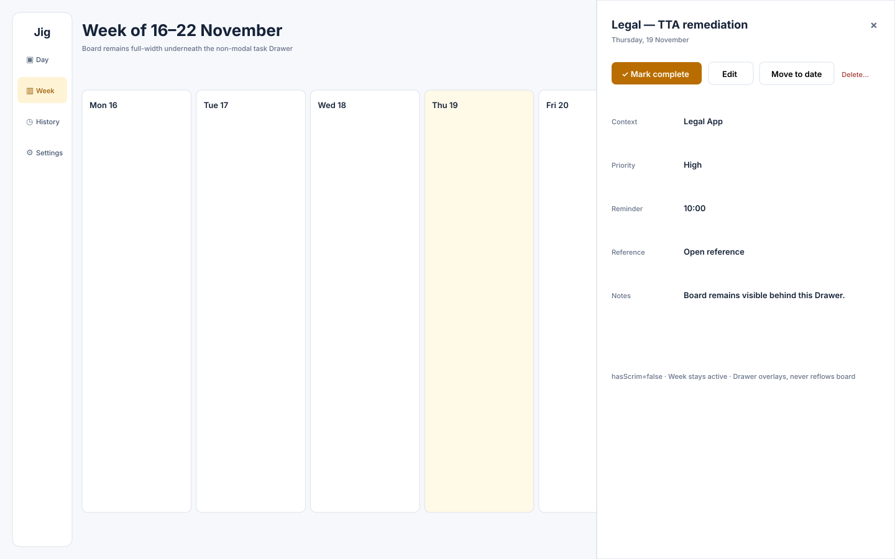

# Jig — UI solution design and visual reference contract

**Status:** Binding v1 UX/UI realization v0.6, 2026-11-17. Functional structure, compact Day-first navigation, fluid Week canvas, shared master-detail Task workspace, Astryx-first component/layout ownership, Option A branding, Jig Light/Dark theming and browser evidence are governed.
**Governing behavior:** [Planning workbench functional design](../requirements/planning-workbench.md), JIG-FR-01–22.
**Technical foundation:** [Technical solution](../architecture/technical-solution.md), especially Astryx/dnd-kit ownership, service feedback and Git status. **Brand/theme authority:** [Brand and theme system](brand-and-theme.md).
**Purpose:** Turn the accepted early mobile/day/week/editor mockups into a versioned interface baseline while distinguishing layout intent from noncanonical visual decoration.

## 1. Source mockups and governed reference assets

The original design exploration used the temporary product name **Day**. It established the correct interaction direction: date-first weekly calendar/board, selected-day focus, compact title-first tasks, optional context/priority/reminder, drag handles, one task editor and a small completed region. The product's name is **Jig**.

The current repository includes eight **versioned SVG structural references**. The original four screens are corrected reconstructions of the approved Day-labelled layouts; History, Settings/Sync and save/sync failure states were added to close the Jig screen contract. Together these references govern structure, hierarchy, density and representative visual character. They are rendered in light mode for review and do not imply a light-only product or require duplicate dark-mode mockups.

| Governing artifact | Screen | Structural meaning |
|---|---|---|
|  | [Desktop weekly planner](reference/desktop-week.svg) | Compact rail plus full available planning canvas with seven fluid day tracks and visible cross-column movement targets |
|  | [Desktop Week selected-task workspace](reference/desktop-week-task-drawer.svg) | Selected Task detail/edit/create/move workspace sliding from the right without reflowing or leaving Week |
|  | [Desktop day view](reference/desktop-day.svg) | Compact rail, selected-date attention list, completed group and docked right Task workspace |
|  | [Desktop history](reference/desktop-history.svg) | Lightweight completion history grouped by actual completion date |
|  | [Desktop settings/sync](reference/desktop-settings-sync.svg) | Repository, service, appearance and synchronization controls |
|  | [Mobile narrow day](reference/mobile-day.svg) | Compact date strip and one attention list at narrow widths |
|  | [Narrow Task workspace](reference/mobile-editor.svg) | Right-side Drawer editor with explicit Save/Cancel; permanent Delete confirmation is separate |
|  | [Save/sync states](reference/sync-failure-states.svg) | Honest local-save and Git synchronization state/failure presentation |

### Original screenshot provenance

The original raster files inspected when this design was authored were:

| Original filename | SHA-256 | Screen mapping |
|---|---|---|
| `day_by_pontivus_weekly_planner.png` | `f7ec8d8a105fa232d21958a74c58df36061b043fe3cd62469ec0ed9f486a7119` | desktop-week |
| `day_planning_dashboard_jan_23.png` | `086dc27cda6b89e5db1a62ed582da316c373dbfb7177de932ee32c414d01ef7f` | desktop-day |
| `day_by_pontivus_planner.png` | `d0a9e2d0316dc950d44cf03220006676995213087a415f72af138b037ea8a270` | mobile-day |
| `day_task_editor_mockup.png` | `d1bbaaedd185060673f4bff146585d17b92e17d6a49745fef958ca9bf04e5ea1` | mobile-editor |

The original PNG bytes are **not** yet stored in the repository; their hashes and corresponding governed SVG reconstructions are recorded here so the sources can be verified and imported later if desired. Do not substitute an unrelated stock image or relabel the originals as Jig production screenshots. The versioned SVG files define the current reviewed **structural** baseline; pixel-perfect final rendering must be certified from the running Astryx UI.

## 2. Information architecture

The desktop IA has exactly **Day**, **Week**, **History**, and **Settings** as meaningful destinations, in that navigation order. **Today** is a shortcut that selects the current local civil date within Day, not a separate destination. A separate **Board** destination is redundant: Week already is the dated Kanban board. The original mockups' Plan/Day/Board duplicates are not required screens.

- **Week** is the principal weekly planning/rearrangement surface: Monday–Sunday buckets, current/selected date emphasis, per-day ordered outstanding tasks, quick-add scoped to each date and cross-day drop targets. Long days scroll without losing date headings. The board consumes the available desktop canvas with seven fluid columns whose product-level minimum is 10rem/160px; wider viewports make the columns wider rather than leaving dead space.
- **Day** is the default operational entry surface, initially selecting the current local civil date. It shows one canonical outstanding sequence for that date after daily rollover, then a compact Completed group and on-demand task detail. The Today shortcut selects the current local civil date; changing selection itself never reschedules tasks.
- **History** is a lightweight dated list grouped by actual completion date, not a dashboard. Each completed row shows the Task's canonical scheduled date at completion plus actual completion time, and has an explicit open/actions affordance so the same Task can be reopened or permanently deleted after confirmation.
- **Settings** exposes theme, browser-notification permission/support state, configured repository path as read-only context, coarse synchronization state/action, service health, local database health, portable-data/repository-adapter health and diagnostics. It does not expose repository migration, remote-name configuration, branch/ref/worktree state, Git history/merge/conflict workflows, or developer tooling.
- **No separately persisted boards, projects or queues.** Context is a short optional Task label and may be displayed or used as a filter, not an independent domain.

### Onboarding and installed lifecycle

The app's very first interaction is the **one-script installer** described in [Technical solution §3.1](../architecture/technical-solution.md). The script selects and validates the personal Git repository and configures the `jig` command + local background service. The user then opens the existing service with `jig` and immediately reaches Day on the current local civil date; Week remains one navigation action away. There is **no repeated onboarding wizard on every run**.

A compact, always-available status control must truthfully distinguish:
- **Saved locally / Synced:** latest local edits are committed to SQLite and the repository integration boundary reports the latest exported snapshot synchronized.
- **Sync pending / Retrying:** local data is safe; export or repository synchronization is still outstanding.
- **Local only:** no remote is configured; local DB and local Jig repository records continue normally.
- **Sync issue:** repository synchronization cannot currently complete, but successful local Task saves remain safe.

The UI does **not** classify the cause as divergence, merge conflict, branch state or another Git-topology concept, and it provides no Jig conflict-resolution workflow. Diagnostics may expose the underlying repository-adapter error for troubleshooting, but repository reconciliation happens with external Git tooling. The UI must not present an ordinary local edit as synchronized until the repository boundary reports success. A failed local save is a different, workflow-critical state and is displayed near the edited Task.

## 3. Visual language

Use the published **Astryx 0.7.13 core** with Jig's canonical theme defined by [Brand and theme system](brand-and-theme.md). `jigTheme` extends Astryx Neutral so Astryx continues to own spacing, typography mechanics, component structure and semantic status families, while Jig owns the product palette and its Light/Dark role mapping.

Theme ownership is singular:

- `ui/src/theme.css` owns raw Jig Ink/Amber/Paper primitives;
- `ui/src/jig-theme.source.ts` is the only authored semantic mapping from those primitives into Astryx roles and extends `@astryxdesign/theme-neutral/built`;
- pinned `@astryxdesign/cli@0.7.13` compiles that source with `astryx theme build` into committed `ui/src/jig.js`, `ui/src/jig.css` and declarations; generated artifacts are compiler-owned and are never hand-edited;
- `ui/src/styles.css` imports the generated theme CSS and styles only Jig-owned product composition using public Astryx tokens;
- `ui/src/app.tsx` imports the generated `jigTheme` from `ui/src/jig.js` and mounts the one root Jig Theme owner;
- CI runs `theme build --check` so source/artifact drift is a release failure.

### 3.1 UI implementation authority

The visual reference does **not** authorize bypassing the component architecture. Implementation order is mandatory:

1. this UI solution and the governed SVGs define product structure, hierarchy, density and genuine structural dimensions;
2. pinned Astryx public APIs define application shell, navigation, responsive shell behavior, list/field/button/link/drawer/dialog anatomy, spacing mechanics and semantic styling;
3. Jig React composition supplies only product-specific structures such as seven dated Week buckets, the shared Task workspace, the Day docked master-detail relationship and Settings information grouping;
4. Jig CSS supplies only the remaining Jig-owned geometry and consumes public Astryx tokens;
5. browser geometry assertions and screenshots verify the implementation; they do not justify private overrides or compensating layout rules.

The pinned Astryx `AppShell` is the application frame. Use its `sideNav`/mobile-navigation contract and the public `SideNav` family for primary destinations. Do not place another complete shell inside AppShell, duplicate the main landmark, or reproduce library-owned responsive navigation with raw parallel chrome.

The desktop SideNav is intentionally compact: approximately **112px** at the canonical 1440px viewport, ordered **Day → Week → History → Settings**, using Astryx semantic icons `calendar`, `viewColumns`, `clock`, and `wrench`. The compact rail keeps the Jig mark but omits low-value supporting copy that would consume the reclaimed planning width. The rail width is a governed product-level structural budget; icon artwork and interaction remain Astryx-owned.

CSS may set the governed product-level dimensions needed to reproduce the structural references, but must not reshape Astryx internals. No Jig rule may rely on an undocumented/private Astryx selector, DOM child structure, StyleX detail or private custom property. Do not use an application-owned high-priority cascade layer, `!important`, or selector escalation to win against the library. The application must also not synthesize Astryx compiler/runtime markers such as `__built` or manually replace the documented theme-build pipeline; those belong only to Astryx-generated artifacts. If a public Astryx primitive cannot realize a governed requirement, document that incompatibility and use the smallest Jig-owned semantic composition built from public Astryx leaves/tokens.

Visual rules:
1. **Compact, low-chrome and scan-oriented.** Prefer list/row structure with subtle boundaries to decorative card stacks; no gratuitous shadows/gradients.
2. **Dates and task titles first.** Priority is secondary: default Normal requires no loud badge; High/Low remain explicit but restrained. Reminders are labeled with a time and are not mistaken for event/time allocations.
3. **One primary action per active surface.** Quick Add is prominent at week level. The Task workspace has a single Save or Move action in its active edit mode. Completion uses an independently accessible checkbox/command.
4. **Clear current date and visible focus.** Selection/current, hover, focus, and save status remain semantically distinguishable without color alone.
5. **Brand restraint.** Ink and Paper own structure/surfaces; Amber is selective identity/action/focus emphasis. Semantic info/success/warning/error remain Astryx status colors and are never replaced with brand Amber.
6. **Theme parity.** System/Light/Dark are mandatory. System follows the browser/platform preference and explicit Light/Dark overrides it locally. The same structure, hierarchy, spacing, focus, selection, priority, completion, save and sync semantics must remain clear in both themes without relying on color alone.
7. **Mobile-first semantics, desktop-first completeness.** Layout may recompose, but no Task value, selected date or pending form draft changes as a side effect of a breakpoint.
8. **Reference SVGs remain structural.** Their wording, geometry and density are reviewable, but the final production palette is the canonical Jig theme. No duplicate dark-mode structural mockup set is required.

## 4. Screen specifications

### 4.1 Desktop Week

Header: “Week of [date range]”, previous/next controls, Today shortcut and Quick Add. The week has seven calendar-date columns using stable local civil dates (Monday-start). Each date has title/date, outstanding count, ordered task rows, a date-specific Add task entry and a visible droppable region even when empty.

The Week board uses the full available desktop planning canvas. Each day track has a 160px minimum and all seven tracks grow evenly with additional width. The old 1168px maximum is not a production maximum; it was only the geometry of the earlier 1440px reference. Horizontal overflow is permitted only when the available desktop canvas is genuinely narrower than seven minimum tracks plus gaps.

Task row: one completion control, title, optional context, exceptional priority marker, optional reminder time, drag handle, and one overflow menu; no fixed time slot, duration, status progression or nested subtask view. Clicking the card selects the Task **without changing destination** and opens the contextual Task workspace.

On desktop Week the Task workspace is an Astryx `Drawer` from the inline end/right with `hasScrim={false}`. It overlays the board rather than reflowing it, so opening details/edit/create/move never narrows the seven day columns. Quick Add and date-specific Add task open create mode in that Drawer; Edit and Move to date switch the same Drawer to their respective modes.

Dnd-kit owns sortable IDs, pointer/touch sensors and drop targets; Astryx owns row appearance. A dragged Task moves to the **exact destination/date/position** where dropped, not a priority-based recalculation. Cancellation restores the prior view. Save failure restores/marks pending the committed order visibly.

The original mockup's additional Board link, excessive Normal badges, green cards and weekly progress metrics are **not MVP authority**; omit them unless separately designed after functional validation.

### 4.2 Desktop Day

A date strip permits switching selected days. The attention list shows the canonical outstanding sequence scheduled for the selected date after service-owned daily rollover. No derived carry-over prefix or originating-date badge is rendered. Completed is compact and separately expandable. Desktop Day has a persistent right-hand Task workspace. Clicking a card selects it in **view** mode; Edit, Add task and Move to date replace that workspace content with **edit**, **create** or **move** mode respectively. Save/Move returns to view with the resulting Task selected. No Task Dialog is mounted on desktop Day. Delete remains destructive and requires the existing confirmation AlertDialog before mutation.

Day view and Week view query the **same Task**; changing Task workspace mode does not create a second editable Task authority. Preserve position changes and reload state. Reminder delivery uses one browser-side eligibility calculation: visible page → Astryx toast; hidden/open page with granted browser notification permission → browser Notification. A reminder never becomes a work item.

### 4.3 Mobile narrow Day

Below the single application-owned **48rem / 768 CSS px** breakpoint, render a deliberate narrow composition rather than the desktop Day DOM with selective CSS hiding.

The governed 414×900 hierarchy is:

1. framed application surface with Jig identity and synchronization status in the first header band;
2. compact destination control showing **Day** on the left and the **Today** shortcut on the right;
3. seven simultaneously visible dates;
4. selected-date title/context;
5. one canonical **Attention** sequence;
6. compact Completed content when present;
7. persistent Quick Add in the governed thumb-reachable position.

All four destinations remain reachable through the compact Astryx/AppShell mobile-navigation path. Do not add a separate full-width desktop toolbar below this hierarchy. Previous/Next need not form an additional row when the seven-date strip already provides direct date selection.

Preserve prominent title-first task cards, touch-sized checkbox and action targets, whole-card drag where supported and a non-drag move-to-date command. Quick Add must not obscure the final task or reminder feedback. The desktop sidebar, desktop Day heading/toolbar and docked inspector are not mounted in the narrow Day composition. Task view/create/edit/move uses the same Astryx Drawer workspace from the inline end/right.

Desktop MVP requires responsive semantic continuity and basic mobile-sized layout validation. It does **not** require installation as a self-contained phone app, native Git commands or background push notifications.

### 4.4 Task workspace and narrow composition

Task creation defaults to **title only** and the initiating date; no forced priority, reminder, time estimate or context. The Task draft/form state is singular across responsive changes. The field hierarchy is Title, Date, Context, Priority, Reminder, Reference, Notes.

There is one Task workspace with presentation modes **view**, **edit**, **create**, and **move**. Desktop Day docks it as the right-hand master-detail panel. Desktop Week and narrow/mobile surfaces present the same content in the public Astryx `Drawer` with `hasScrim={false}`. Do not mount a centered or fullscreen Task `Dialog`, and do not recreate Drawer internals with Jig CSS. The Drawer remains the library-owned overlay/focus/close surface while Jig owns only Task-specific content.

Use explicit Save/Cancel or Move/Cancel controls, persistent form errors on invalid data or server refusal, and preserve the active draft across responsive reflow. Date **editing** applies priority-guided insertion. The distinct **Move to date** workspace mode invokes the canonical exact-position move operation and appends to the selected destination date; drag/drop still uses the exact drop index. Changing priority does not rearrange the task.

Permanent Delete is available from Task detail and remains the only blocking Task dialog through Astryx `AlertDialog`. Creation/edit/move themselves never use a blocking dialog.

## 5. Interaction and component ownership

| UI concern | Canonical owner |
|---|---|
| Application frame and responsive primary navigation | Astryx AppShell + public SideNav/mobile-navigation APIs; Jig owns destination state, not shell mechanics |
| Buttons, icon buttons, links, menus/popovers, lists, labels, fields, dialog/drawer, calendar input, time input, toasts, semantic theme | Astryx published primitives |
| Sortable rows, drop zones, drag overlays, keyboard drag, pointer/touch gesture lifecycle | @dnd-kit/react only; do not activate Astryx List createReorderable on the same row |
| Week/date bucket composition, Day selected-date sequence, mobile strip, empty-date state, completed groups, Task workspace mode/content composition | Small Jig React composition |
| Scheduled date, ordering, daily rollover, initial priority placement, complete/reopen/delete, task identity | Pure Jig planning core |
| Task reads/writes and generic repository synchronization status | Bun service with SQLite plus isolated repository integration adapter |
| Reminder due eligibility and presentation while browser is open | One browser-side timer/eligibility monitor + Astryx useToast + browser Notification API; no background sender/service worker |

CSS ownership follows the same table. Jig may style its own page/region/card wrappers and public root classes it supplies, but it does not style descendants that belong to an Astryx component. Reusable action/navigation mechanics use Astryx Button/IconButton/Link rather than raw `<button>`/`<a>` plus local reset/focus/press CSS, unless a documented public-API incompatibility requires the smallest semantic fallback. Governed outer dimensions may use explicit values; ordinary spacing, radius, typography and control sizing use Astryx public tokens/props. Where desktop and narrow information hierarchy differs, React selects the correct composition at the one semantic breakpoint; CSS is reserved for pure reflow/density inside that composition. Superseded rules are deleted rather than counteracted later in the stylesheet.

Keyboard alternatives **Move up**, **Move down**, **Move to date** invoke the same canonical Task operation as a drag. The drag handle must not swallow checkbox clicks, link navigation or editor opening. Avoid duplicate focus stops on the ListItem's clickable layer and nested controls; verify Astryx + dnd-kit with actual Playwright browser interaction.

## 6. Required browser/UX validation

| Case | Acceptance |
|---|---|
| Week scanning | Seven readable dates with distinct current/selected state; >=160px day tracks at desktop minimum and fluid expansion on wider canvases instead of dead horizontal space |
| Title-only creation | Adds into originating date in a minimum interaction |
| Priority default | Newly created task inserted by functional priority law, existing manual sequence untouched |
| Same-day drag | Exact chosen position persists after reload |
| Cross-day drag | Destination and position persist, source loses item, empty date works |
| Midday edits | Metadata/priority edits preserve manual ordering |
| Completion | Task leaves active list, keeps scheduled date and actual completion time/history |
| Daily rollover | Earlier unfinished Task is automatically moved into the current local date by changing `scheduled_date`; the same moved card appears in the current bucket in Week and Day |
| Delete | Cancelled confirmation makes no mutation; confirmed deletion removes outstanding/completed Task from all current views and remains deleted after reload/Git round trip |
| Responsive reflow | No loss of selected date, selected Task, Task workspace mode/draft or outstanding modifications; no Task Dialog introduced at narrow widths |
| Keyboard and touch | No hover-only essential actions; non-drag alternatives and visible focus |
| Reminder | Visible page => one dismissible toast; hidden/open + granted permission => one browser Notification; permission requested only by explicit user action; no claim when browser closed |
| Local save failure | User sees specific unresolved error, not fake save success |
| Auto-sync lifecycle | Service can save/sync with browser closed; header/settings convey local/synced/pending/local-only/sync-issue truth without Git divergence/conflict semantics |
| Offline use | Editing remains available, Git retries later without blocking |
| Theme parity | System/Light/Dark are all supported; representative Week, Day, editor, Settings and error/status states retain equivalent hierarchy, contrast and non-color semantics in Light and Dark |
| Resource discipline | Responsive reopen and low-idle service measured as part of installer certification |

Use actual approved Astryx and dnd-kit versions in Playwright for final UI evidence; these SVGs alone do not certify pixel fidelity or interaction. Archive browser screenshots from these tests in the repository when implementation begins; they supersede early concept art only after review.

## 7. Design change control

The eight versioned SVGs in `docs/design/reference/` remain the structural baseline for layout, interaction hierarchy and density. Production color, logo use and Light/Dark behavior are governed centrally by [Brand and theme system](brand-and-theme.md); no duplicate dark structural SVG set is required. When an interaction changes, update this document and the relevant SVG together. If only runtime appearance changes to correct Astryx component parity, update implementation and browser evidence without inventing a second canonical visual-token contract.

Do not refer to the previous Day branding as a current product identity. Do not use project-specific task details as content that Jig must store; they exist only as illustrative samples. An implementation plan must link to this document and to [Technical solution](../architecture/technical-solution.md).
