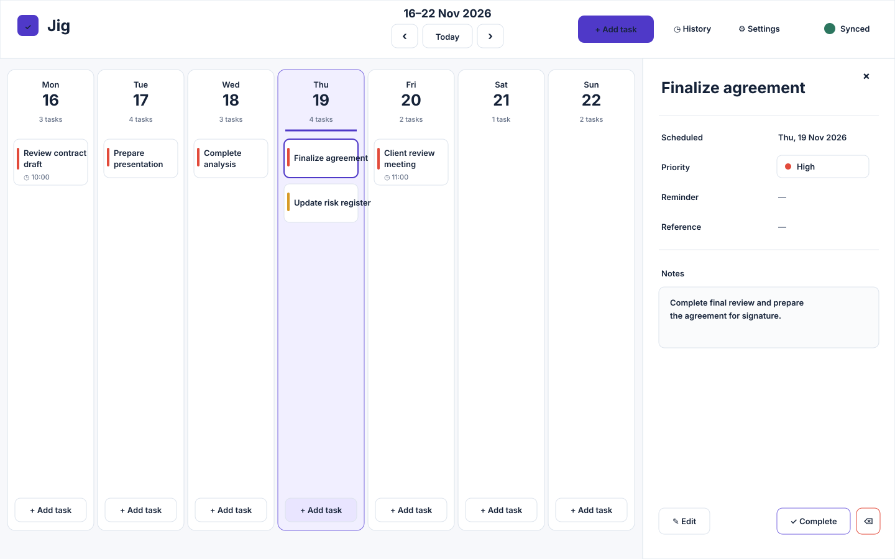

# Jig — UI solution design and visual reference contract

**Status:** Canonical UI solution through v1.1, amended 2026-11-20 after physical-device acceptance exposed compact-header identity/height, interactive-text legibility, Task leading-control alignment and past-date movement feedback defects. For adjacent-week behavior this document owns visual/interaction presentation only; JIG-110-FR-33 is the sole functional authority and JIG-110-SD-43 is the sole paging-mechanics authority. The app-wide configured desktop/mobile hierarchy is governed by the v1.1 application reference below; the existing onboarding/Task-form references remain binding within their scopes. v1.0.x sections remain release history only.
**Governing behavior:** [Planning workbench functional design](../requirements/planning-workbench.md), including JIG-103-FR-01–17, JIG-104-FR-01–16, JIG-105-FR-01–11, JIG-106-FR-01–07, JIG-FR-01–23 and JIG-110-FR-01–33.
**Technical foundation:** [Technical solution](../architecture/technical-solution.md), especially Astryx ownership, the governed Task-movement proof gate, service feedback and Git status. **Brand/theme authority:** [Brand and theme system](brand-and-theme.md).
**Purpose:** Govern Jig's minimal, purpose-built interaction and visual composition across desktop and Android, including v1.1 onboarding, while preserving useful earlier visual evidence without allowing superseded Day/Week/sidebar or technical-process UI structures to remain authoritative.

## 1. Source mockups and governed reference assets

The early design exploration used the temporary product name **Day** and separate Day/Week destinations. Those assets remain provenance only. The v1.0.3 review supersedes that navigation model with one responsive Planner.

The v1.0.3 assets below are retained as historical structural baselines where explicitly noted. The binding v1.0.4 interaction and visual authority is this document together with the functional design and brand/theme contract:

| Governing artifact | Screen | Structural meaning |
|---|---|---|
|  | [Desktop Planner](reference/desktop-planner-v1.0.3.svg) | Historical structural baseline: no sidebar; Jig home at left; page-centered week range above grouped Previous/Today/Next controls; right-side actions/navigation; seven fluid date tracks. v1.0.4 supersedes its heavier chrome and adds explicit Planner navigation. |
|  | [Mobile/narrow Planner](reference/mobile-planner-v1.0.3.svg) | Historical v1.0.3 narrow composition only. v1.0.4 supersedes its selected-date strip/list with seven vertically stacked dated sections; the asset must not be used as authority for day selection. |
|  | [Narrow Task workspace](reference/mobile-editor.svg) | **Historical v1.0.3 provenance only for v1.1 Task-form presentation.** The governed v1.1 mobile reference below supersedes its form hierarchy, density, touch geometry, Repeat and BottomSheet action placement. |
| [Governed v1.1 application UX/UI reference](reference/jig-v1.1-application-ux-ui-governed-reference.html) | [Configured mobile + desktop application shell, Planner, History and Settings](reference/jig-v1.1-application-ux-ui-governed-reference.html) | **Binding v1.1 app-wide authority** for compact bottom navigation, Planner FAB, shell/action prominence, temporal hierarchy, Planner density and configured History/Settings composition. |
| [Governed v1.1 mobile UX/UI reference](reference/jig-v1.1-mobile-ux-ui-governed-reference.html) | [Android/narrow onboarding + complete Task form](reference/jig-v1.1-mobile-ux-ui-governed-reference.html) | **Binding v1.1 authority** for onboarding hierarchy/states and the complete mobile Task form, including ≥48px touch geometry, vertical form language, progressive Repeat disclosure, BottomSheet scrolling and action placement. |
| [Governed v1.1 desktop onboarding + Task-form reference](reference/jig-v1.1-desktop-onboarding-task-form-governed-reference.html) | [Desktop onboarding + complete Task form](reference/jig-v1.1-desktop-onboarding-task-form-governed-reference.html) | **Binding v1.1 authority** for desktop onboarding composition and the complete Drawer Task form/Repeat interaction. |
|  | [Desktop history](reference/desktop-history.svg) | Lightweight completion history; uses the same top application navigation |
|  | [Desktop settings/sync](reference/desktop-settings-sync.svg) | Appearance, notification and operational status/settings |
|  | [Save/sync states](reference/sync-failure-states.svg) | Honest local-save and repository synchronization feedback |

The older `desktop-week.svg`, `desktop-week-task-drawer.svg`, `desktop-day.svg` and `mobile-day.svg` are historical design inputs after this revision. They must not be used to reintroduce a sidebar, Day/Week destinations, a Day completed section, a split date-navigation model, or a right-side mobile Drawer.

### 1.1 v1.1 governed application, onboarding and Task-form authority

The three v1.1 HTML references above are **normative product-design authority**, not implementation screenshots and not optional inspiration. The app-wide reference owns configured shell/navigation/Planner/History/Settings hierarchy; the mobile and desktop onboarding/Task-form references own those surfaces. Together they govern information hierarchy, user-visible state composition, responsive arrangement, form density, product-level interaction geometry and primary/secondary action hierarchy within their declared scopes. Exact reusable component anatomy, theme rendering, accessible primitive behavior and token realization remain Astryx-owned.

Authority precedence inside this scope is:

1. functional requirements define observable behavior and domain semantics;
2. this UI solution plus the three governed v1.1 references define the user-visible hierarchy, responsive composition and product-level geometry;
3. pinned Astryx public APIs define reusable component mechanics and semantic styling;
4. Jig React/CSS supplies only the smallest product-specific composition needed to realize that authority;
5. current implementation, historical SVGs and screenshots are evidence only.

The **mobile reference is also the default v1.1 mobile form interaction/presentation standard** for onboarding, the Task BottomSheet and directly analogous form surfaces: visible labels, one readable vertical hierarchy, natural scrolling inside the owner, ≥48×48px ordinary touch targets, visibly separated standalone actions, one clear primary action, subordinate secondary actions, semantic iconography, and no process-shaped technical choreography. A more specific canonical surface contract may override that default, but implementation convenience may not.

The complete Task form remains present in every Repeat state:

`Title → Date → Repeat → Reminder → Priority → Context → Reference → Notes`

Repeat progressively discloses its controls **in place** between Date and Reminder. A recurrence-only form, a reference that visually stops after Repeat, or a second recurrence Save is non-conforming. On mobile, weekday controls wrap when necessary to preserve the interaction budget rather than squeezing seven sub-48px targets into one row.

For onboarding, both governed references establish **product story before infrastructure**: Jig identity/value/local-first continuity first, then the genuine repository choice, followed by only the provider mechanics required for the chosen path. Desktop uses a stable value/context region plus bounded setup pane; Android/narrow uses one bounded vertical flow. Neither platform becomes a Git/clone/database setup utility. Successful setup transitions directly to Planner; a zero-Task week may show the governed lightweight `Your week is clear / Add your first task` activation as a normal Planner empty state, not persisted onboarding state.

The original raster provenance recorded in repository history remains useful for traceability, but those images are not production screenshots or current structural authority.

## 2. Information architecture

Jig has one primary planning destination: **Planner**. Planner remains the default/Home destination and is also shown explicitly in the desktop right-side navigation beside History and Settings so destination state is immediately legible. The Jig mark remains an additional Home affordance. On compact/mobile, Planner, History and Settings are the three persistent peer destinations in a bottom navigation bar.

The only secondary destinations are **History** and **Settings**.

- Clicking the Jig product mark/wordmark returns to Planner.
- Desktop exposes Planner, History and Settings directly in the right side of the global header.
- Compact/mobile exposes the same three destinations persistently in bottom navigation; a hamburger/popover is not the primary destination owner.
- There is no desktop SideNav, mobile navigation drawer, separate Day destination, separate Week destination, or Board destination.
- Today is a temporal shortcut inside Planner, not a destination.
- Planner-only **Add task** is a single prominent compact/mobile FAB above the bottom navigation; History/Settings do not render it.

Planner owns one temporal presentation state: the displayed week. Desktop renders all seven outstanding date sequences as columns. Narrow/mobile renders the same seven sequences as vertically stacked dated sections. There is no selected-day state or selected-day subview. Completed Tasks are absent from Planner and live in History.

### Onboarding and installed lifecycle

A fresh Jig installation may open before a planning-data repository is configured. Onboarding is therefore a first-class **Jig application state**, not a separate installer-like utility and not a multi-step technical wizard.

From the first rendered frame on desktop and Android, onboarding uses the same governed Jig application frame, active theme, brand/header ownership, safe-area behavior, body background, typography, spacing language and Astryx component system as configured Jig. Planner/History/Settings navigation is not shown as available before configuration, but the product must remain visually and structurally identifiable as Jig.

The onboarding body is deliberately distinct from Planner content and intentionally minimal:
- one concise orientation explaining that Jig needs a planning-data home;
- on Android, one primary **Connect GitHub repository** action;
- on desktop, **Connect GitHub repository** plus the secondary genuine choice **Use an existing local repository**;
- one passive connecting/progress presentation while Jig performs automatic work;
- one repository chooser only when multiple eligible repositories require a real user choice;
- one bounded needs-attention/error presentation when Jig cannot continue without user involvement.

The UI must never expose provider/Git implementation sequencing as a succession of controls. Authorization polling, access discovery, pagination, clone/fetch, checkout placement, validation, adoption, SQLite initialization and initial synchronization remain behind the connecting state.

GitHub Device Flow has one unavoidable provider-owned interaction that is part of the normal connection experience: GitHub returns an 8-character authorization code that the user must enter on GitHub's fixed device-verification page. Jig therefore keeps one **Connecting repository…** surface visible with the code, a compact **Copy code** affordance and an **Open GitHub** fallback while automatically opening GitHub when permitted and polling in the background. The code is shown because GitHub requires it; polling cadence, pending/slow-down states and token exchange are never shown as steps.

After authorization, GitHub may also require installation/repository-access selection on its own surface. Jig opens that provider surface when needed, waits, and re-checks access automatically when the app/browser becomes active and through bounded background retry. Closing or returning from GitHub is not itself treated as proof that access was granted because organization policy may turn the action into an approval request.

There is no normal-flow **Refresh access**, Jig-owned **Grant repository access**, **Manage GitHub access**, manual authorization polling, checkout-path choice or separate adoption action. When provider access must change, the only Jig action is a user-level **Open GitHub**/continue-access affordance that hands control to GitHub's own installation/access page. Reconnect follows the same rule: one Jig recovery intent, the same required GitHub code/consent interaction, then automatic continuation without repository selection or re-acquisition.

A compact always-available synchronization indicator truthfully communicates the user-level outcome: **Local only**, **Syncing**, **Up to date** or **Needs attention**. When remote continuity has a problem but current work is safe locally, the user-facing copy says so directly. Low-level Git/service/database facts remain available only as secondary diagnostics.

## 3. Visual language

Use the published **Astryx 0.7.13 core** and its public theme system as the reusable visual foundation. v1.0.6 exposes thirteen complete dual-mode application themes: Jig; Astryx Neutral, Butter, Chocolate, Matcha, Stone and Y2K; and the governed community families Gruvbox, Dracula, Solarized, Nord, Catppuccin and Tokyo Night. Pinned Astryx Gothic is dark-only and is intentionally not selectable because every Jig theme must satisfy the same Light/Dark/System contract. Theme family changes palette/typography/component-theme presentation only; application structure and product semantics do not fork.

Theme ownership remains singular:

- one typed presentation registry owns the exact thirteen Theme choices and one independent `System | Light | Dark` appearance value;
- the default Jig theme retains the governed Ink/Amber/Paper palette; the Astryx presets reuse their pinned 0.7.13 theme definitions; community themes are complete semantic palette mappings over Astryx Neutral mechanics;
- all Jig-authored theme sources are compiled with pinned `@astryxdesign/cli@0.7.13`; generated artifacts are compiler-owned and never hand-edited;
- one shared Jig product-token contract maps today, selection, navigation, drag, priority, operational status, Task elevation and brand paint to theme semantics;
- `ui/src/styles.css` remains composition-only, consumes semantic tokens and never branches on theme name or embeds theme palette literals;
- `ui/src/app.tsx` mounts exactly one root Astryx `Theme` using the selected Theme preset plus independent appearance mode;
- CI verifies every authored theme source/artifact pair, not just the default Jig theme.

### 3.1 UI implementation authority

The visual reference does **not** authorize bypassing the component architecture. Implementation order is mandatory:

1. this UI solution and the governed SVGs define product structure, hierarchy, density and genuine structural dimensions;
2. pinned Astryx public APIs define application shell, navigation, responsive shell behavior, list/field/button/link/drawer/dialog anatomy, spacing mechanics and semantic styling;
3. Jig React composition supplies only product-specific structures such as the three-zone Planner header, seven dated Planner buckets, narrow seven-section stack, shared Task workspace and Settings information grouping;
4. Jig CSS supplies only the remaining Jig-owned geometry and consumes public Astryx tokens;
5. browser geometry assertions and screenshots verify the implementation; they do not justify private overrides or compensating layout rules.

The pinned Astryx `AppShell` is the application frame, but v1.0.3 deliberately omits `sideNav` and disables the AppShell automatic mobile drawer. Use the `topNav` slot plus public Astryx Button/IconButton/DropdownMenu or Popover primitives for the approved Jig header. Do not place another complete shell inside AppShell or duplicate the main landmark.

The desktop header is one Jig-owned three-zone composition: Jig Home at left, the centered Planner temporal centerpiece, and Add task + adjacent Planner/History/Settings navigation + synchronization state at right. The center must remain optically/page centered despite unequal side-zone widths. Planner, History and Settings use semantic icons plus accessible labels from one shared destination definition; there is no SideNav.

CSS may set the governed product-level dimensions needed to reproduce the structural references, but must not reshape Astryx internals. No Jig rule may rely on an undocumented/private Astryx selector, DOM child structure, StyleX detail or private custom property. Do not use an application-owned high-priority cascade layer, `!important`, or selector escalation to win against the library. The application must also not synthesize Astryx compiler/runtime markers such as `__built` or manually replace the documented theme-build pipeline; those belong only to Astryx-generated artifacts. If a public Astryx primitive cannot realize a governed requirement, document that incompatibility and use the smallest Jig-owned semantic composition built from public Astryx leaves/tokens.

Visual rules:
1. **Intent-first, not process-first.** Controls represent user goals, genuine choices and actionable recovery. Internal protocol/state-machine phases never become a row of buttons merely because the implementation has separate operations. Passive progress replaces technical choreography.
2. **Compact, low-chrome and scan-oriented.** The week is an open canvas, not seven boxed panels. Prefer whitespace, typography and at most hairline separators to heavy outlines. Task cards remain discrete interactive units but use restrained borders/shadows. Avoid nested frames, thick lane borders, gratuitous shadows/gradients and repeated decorative lines.
3. **Dates and task titles first.** Priority is secondary: default Normal requires no loud badge; High/Low remain explicit but restrained. Reminders are labeled with a time and are not mistaken for event/time allocations.
4. **One primary mutation per active form.** Add task is prominent at Planner level. The editable Task workspace has Save as its primary form action; completion/reopen and Delete remain independent Task commands rather than alternate form modes.
5. **Distinct state vocabulary.** Current day, selected Task, drag target, priority, focus and operational status are different semantics and must not collapse onto one visual treatment. The default Jig palette currently renders these as teal/info/Amber/status families, but v1.0.6 theme families may change the literal hues. Their semantic roles, precedence and non-color cues remain invariant.
6. **Brand restraint.** The default Jig theme retains Ink/Paper/Amber identity. Other theme families may use their own governed palette. The application must never force Jig Ink/White/Amber onto product states or in-application wordmark paint when another theme is active.

#### v1.0.4 state appearance matrix

**Color authority:** the exact component/state semantic owners, Light/Dark resolution, product aliases, button variants, hover/pressed/focus/disabled behavior and prohibited substitutions are governed by [Technical solution JIG-106-SD-04](../architecture/technical-solution.md) and the [Brand/theme contract](brand-and-theme.md). The literal Jig hues in the historical v1.0.4 table describe the default Jig theme only; every v1.0.6 theme preserves the same meanings without being required to use those hues.

| UI state | Appearance contract |
|---|---|
| Desktop exact current day | subtle teal column/header border + teal date typography; no lane fill |
| Planner selected day | **none** — day selection is not a product state in v1.0.4 |
| Selected Task | subtle info-blue muted surface + info-blue border; no Amber/teal selection fill |
| Task High priority | narrow error/red leading cue; explicit High label where shown |
| Task Normal priority | quiet Ink/neutral leading cue; no loud badge |
| Task Low priority | narrow calm success/green leading cue; explicit Low label where shown |
| Drag source/target | transient Amber/accent outline/overlay only during direct manipulation |
| Keyboard focus | Amber focus ring only; does not change the persistent state color |
| Active History/Settings destination | quiet neutral active treatment, not the selected-Task or drag-target treatment |
| Current work safe locally | restrained success semantics when this fact needs explicit communication |
| Synchronization in progress | restrained neutral/progress or warning semantics; no Git transport terminology required |
| Up to date / Local only | restrained success family, distinguished by explicit user-level label/state |
| Synchronization needs attention | error/warning family with direct copy stating whether work remains safe locally |
| Technical Git/service/database detail | secondary Diagnostics only; never the primary status vocabulary |
| Unknown status | neutral grey |

7. **Theme and appearance parity.** Theme family and appearance are independent. Every one of the thirteen v1.0.6 Theme presets supports System, Light and Dark; System follows browser/platform preference changes while explicit Light/Dark stays explicit. The same structure, hierarchy, spacing, focus, selection, priority, completion, save and sync semantics remain clear without relying on color alone.
8. **Settings-only configuration.** Theme family is selected through one bounded Theme selector and appearance through one System/Light/Dark segmented control in Settings → Appearance. No theme or mode control appears in Planner, the header, Task cards/workspace, History actions or contextual menus.
9. **Theme-aware brand.** The compact header uses one canonical Jig wordmark geometry. Its foreground and alignment pin consume the active theme's semantic brand roles; changing theme/mode never changes logo geometry or product identity.
10. **Reminder presentation.** Due reminders use browser/OS Notification only while Jig is open and permission is granted. Page visibility/focus does not change channel. There is no reminder Toast fallback or duplicate.
11. **Mobile-first semantics, desktop-first completeness.** Layout may recompose, but no Task value, displayed week, selected Task or pending form draft changes as a side effect of a breakpoint or appearance change.
12. **Reference SVGs remain structural.** Their wording, geometry and density are reviewable; production palette/brand paint is resolved by the active semantic theme. No duplicate structural mockup set is required for each theme.

## 4. Screen specifications

### 4.0 v1.1 onboarding application state

Onboarding uses the same outer application composition and one shared setup semantic owner on desktop and Android. The governed references deliberately recompose the body by platform; this is not permission to create separate onboarding products or state machines.

**Header:** render the canonical theme-aware Jig wordmark/identity in the governed application header from the first frame. The header owns safe-area inset on Android. Do not render Planner temporal controls, Add task, Planner/History/Settings destination navigation or synchronization status before a repository is configured. The header remains product chrome, not an onboarding step indicator.

#### Initial composition — product story before infrastructure

The first screen establishes why Jig needs a planning-data home before asking for GitHub authorization. The information hierarchy is:

1. Jig identity / concise welcome;
2. a short value statement centered on planning continuity and keeping planning data under the user's control;
3. restrained reassurance for local use, portability through Git and provider-owned authorization;
4. the genuine setup choice available on the platform;
5. only then, minimal supporting copy about the provider handoff.

Semantic icons from the Astryx/Jig icon system may reinforce those reassurance concepts. Decorative hero illustration is not required and must not push the primary setup action below the useful initial mobile viewport.

**Android/narrow:** use the governed bounded single-column composition. **Connect GitHub repository** is the one primary setup action. Do not render the desktop local-worktree choice.

**Desktop:** use the governed two-region composition, not a centered phone-width setup card. The left region is a stable value/context region; the right region is a bounded setup pane. The initial setup pane contains primary **Connect GitHub repository** and secondary **Use an existing local repository**. When setup advances, the right pane changes state while the left value/context region remains visually stable.

Desktop onboarding must not show an idle/persistent page scrollbar when the governed two-region composition fits the available AppShell body. The onboarding content must size against the **remaining application viewport below the 44px header**, rather than creating a second 100%-height scroll surface inside that body. If a genuinely short viewport or a taller onboarding state requires overflow, the existing application content owner may scroll so all controls remain reachable; do not globally disable scrolling or clip setup content merely to hide scroll chrome.

The desktop local-repository path stays inside that bounded setup pane: one absolute repository-path field, validation/supporting copy, **Use this repository**, and Back/Cancel. It is provider-neutral and does not become a filesystem-browser wizard.

#### GitHub connection presentation

After Connect, the same onboarding owner enters one coherent connecting state. That state has user-facing content variants without becoming a stepper:

1. **Authorize Jig on GitHub.** Show the GitHub-generated device code prominently enough to copy accurately, provide **Copy code**, and open GitHub's fixed device-verification page automatically where permitted. If opening is blocked or the user returns before completing authorization, expose one **Open GitHub** action. Supporting copy explains that Jig continues automatically; there is no Refresh.
2. **Repository access on GitHub.** If the authorized token cannot see an eligible Jig App installation/repository, explain that repository access must be chosen on GitHub and provide/open the GitHub-owned installation/access page. When the user returns, Jig re-checks automatically. Do not claim installation or approval succeeded until GitHub's API actually exposes the installation/repository.
3. **Getting your plan ready…** While clone/validation/adoption/database initialization run, show passive progress only. Do not expose those technical phases individually.

The authorization code is a provider requirement, not optional developer detail: it must remain visible until GitHub authorizes, denies or expires that Device Flow. Do not substitute a fake one-click Continue that conceals a required code-entry action and leaves the user stranded on GitHub.

If repository selection is necessary, render one simple chooser using human-readable `owner/repository` identity from the complete authoritative GitHub App-accessible repository set. The list may span multiple accounts/organizations and must represent all paginated results, not only the first API page. If exactly one eligible repository exists, Jig may continue automatically. After an explicit selection, return immediately to the single connecting state.

Provider installation/access UI can legitimately show organization-owned choices such as Install, Request or selected repositories. Jig does not reproduce those controls. If organization policy prevents immediate access, Jig remains truthful: **GitHub has not made this repository available yet** and provides the provider handoff/retry only as needed. It must not infer or display **Waiting for approval** unless that state is actually known.

There is no Jig-owned **Refresh access**, **Grant repository access**, **Manage access** or manual poll control.

**Needs attention:** map technical failure to the smallest real recovery:
- authorization denied/expired → **Try GitHub authorization again** and generate a fresh code;
- credential refresh/revocation after setup → **Reconnect GitHub**;
- GitHub repository access absent → **Open GitHub** to review/install/request repository access, then continue automatic re-check;
- transient network failure → automatic retry first, with **Try again** only after bounded retry is exhausted;
- clone/adoption failure → concise product-level failure plus **Try again** or repository re-selection when that choice can actually change the outcome.

Raw HTTP codes, `authorization_pending`, `slow_down`, installation IDs, filesystem paths, Git commands, transport phases and database terminology belong in diagnostics, not this surface.

Successful setup transitions directly from onboarding into Planner without a completion ceremony or additional Continue button. When the displayed week has no Tasks, Planner uses the governed lightweight empty-week activation: a quiet empty-state treatment, concise orientation and **Add your first task** action. It is Planner content, not an onboarding destination or persisted onboarding-progress state.

### 4.1 Desktop Planner

The approved desktop composition is the v1.0.3 reference.

**Header:** one compact full-width application header with three zones.

- **Left:** Jig product mark/home affordance.
- **Center (v1.0.5):** one inline temporal group: **Previous chevron · 16–22 Nov 2026 · Next chevron · Today**. The range is informational and sits between the arrows; Today remains an explicit action. This supersedes the older two-line reference geometry.
- **Right:** **Add task**, adjacent **Planner · History · Settings** navigation, compact synchronization state. Planner is visibly active on the Planner surface.

The temporal centerpiece is centered on the page, not merely centered in the leftover space between left/right controls.

The week range uses compact formatting without “Week of” or a separate month title. Previous/Next shift the displayed week by exactly seven days. Today returns to the week containing the current local date.

The board contains seven equal-width Monday–Sunday tracks. Each track has a 160px width minimum and expands with the available desktop canvas. Vertical height is content-driven, so lanes may end at different heights. The tracks are visually open: no lane cards, no thick outlines and no framed column containers. Use spacing and at most a subtle hairline divider between adjacent days. Date headers use full weekday names, for example `Thursday 19`; they are non-selectable date signifiers and contain a compact `+` immediately adjacent to the label for date-specific creation.

The exact current local civil date alone receives the subtle teal current-day border/header treatment; the same weekday in another displayed week does not. Selected Task uses its own subtle info-blue card selection treatment. Drag-over uses transient Amber. Priority uses red/neutral/green cues. Do not conflate these states.

Task cards are compact and title-first. They are the primary discrete surfaces inside the otherwise open week canvas. Use a restrained surface, thin border and minimal elevation only where needed for separation; avoid heavy outlines or nested chrome. Small semantic icons may identify reminder, context/reference, completion or other visible metadata states, while the title remains dominant. A thin leading color/accent may encode priority for scanning, but color is not the only priority signal and Normal remains visually quiet.

Clicking a Task opens the full editable Task form directly in the non-blocking right workspace without moving it. There is no separate read-only details step and no Edit indirection. The workspace overlays the board and never narrows/reflows the seven tracks. Clicking blank Planner/History content dismisses the workspace; clicking another Task retargets it. Global Add task derives its default date from the viewed week and the current local weekday; in the current week this is today. Per-date Add is the compact `+` in that date header and opens the same full form for that explicit date. The former full-width bottom-of-lane Add control does not exist.

Remove descriptive/meta copy. The desktop interface must not display phrases such as “Week of”, “full available canvas”, “selected date view”, “Today is a shortcut”, or similar explanatory design text.

### 4.2 History and Settings — one reading hierarchy across desktop and mobile

Planner, History and Settings share the same global application-header language and destination owner. History remains a chronological reading surface. Settings is a configuration/status reading surface; it is **not a dashboard** and must not use equal cards merely to fill a grid.

For History and Settings, the **application header is the sole destination-heading owner**:

- History: **History** + `Completed work grouped by actual completion date`;
- Settings: **Settings** + `Repository, synchronization, appearance and diagnostics`.

The title is the page semantic `h1`; the body begins immediately with meaningful content and never repeats that heading.

History and Settings continuously use one centered **50rem / approximately 800px maximum reading measure** when space permits. Below that width the content consumes the available width. Mobile retains component-owned internal padding even though the outer application frame is full-bleed.

#### Settings information architecture

Settings uses one vertical sequence of content-sized groups. Do not render a 2×2 dashboard, equal-height cards, large empty minimum-height boxes or one-line values floating in oversized surfaces.

The canonical order is:

1. **Data & sync**
2. **Appearance**
3. **Notifications**
4. **Diagnostics / technical details**

**Data & sync** is one coherent continuity group because the user asks one question: “Where is my planning data, is my current work safe, and is continuity up to date?” It contains compact rows:

- **Planning data** — human-readable repository identity or **Local only**, with short supporting copy;
- **Saved on this device** — explicit local durability/safety state;
- **Synchronization** — **Local only / Syncing / Up to date / Needs attention**, with concise supporting copy;
- an action row only when a genuine user recovery is required: **Reconnect GitHub**, **Try again**, or equivalent. No standing primary **Sync now**.

The local-first promise is supporting text inside this group when it clarifies safety; it is not another decorative panel.

**Appearance** contains only Theme and System/Light/Dark.

**Notifications** is its own semantic group, not a child of Appearance. It presents permission/scheduling state, concise consequences and only the action currently available (Enable, Android settings, exact-timing settings as applicable).

**Diagnostics / technical details** is visually subordinate and **collapsed by default**. Its summary communicates whether technical details are healthy/available without forcing them into the default scan. Expanding it reveals repository path, Jig service, local database, portable-data adapter state, Local Git, Remote Git, sanitized remote identity and the expert **Sync now** trigger. It must not expose credentials or provider internals.

Rows use a stable label → primary value → optional supporting text hierarchy. Values align consistently; long repository/path text wraps rather than shrinking neighboring controls. Section height is content-driven.

On desktop the 50rem reading column remains intentionally linear; do not split Data & sync into two columns merely because horizontal space is available. Small related controls such as Theme/Appearance may use internal responsive composition, but the section order and reading sequence stay the same.

On mobile every interactive Settings row/action obeys the application-wide 48px touch-target rule. Diagnostics disclosure, notification actions and reconnect/retry must remain easy to operate with one hand and must not create dense button clusters.

For managed GitHub repositories, credential renewal remains invisible. **Reconnect GitHub** appears only when automatic renewal is impossible or authorization is rejected, and returns automatically to synchronization without repository selection/re-acquisition.

### 4.3 Narrow/mobile Planner

Below the 73rem Planner breakpoint, render a deliberate touch-first composition rather than compressing desktop controls.

The compact configured hierarchy uses three persistent regions:

**Top application row — 52px normal-content target, <=56px at normal text sizing**
- canonical Jig wordmark/Home remains at the start on **Planner, History and Settings**;
- active destination title is centered independently of side-zone width: **Planner**, **History** or **Settings**;
- restrained synchronization indicator remains at the end;
- compact History/Settings omit the explanatory subtitle from the bar rather than replacing the Jig identity or growing another text line;
- no Planner Add button and no hamburger primary-navigation trigger.

**Temporal row — Planner only, 52px normal-content target, <=56px at normal text sizing**
- Previous week;
- flexible readable week range as the dominant temporal label;
- Next week;
- explicit **Today** text action.

**Bottom navigation — configured application only**
- exactly Planner, History and Settings from the shared typed destination owner;
- persistent across configured compact Planner/History/Settings;
- current destination is clear through icon + label + active treatment;
- every navigation item has a >=48px interaction target;
- bottom system/gesture safe-area inset belongs to this navigation owner.

Planner additionally renders one bottom-end **Add task** FAB above the bottom navigation. It is the only control allowed the highest action prominence on the compact Planner.

Healthy synchronization is deliberately subordinate. Its visible glyph/status dot may be much smaller than 48px while the owning interaction target remains >=48×48px. Pending/retrying/error may increase semantic salience and a genuine problem may add the governed banner/recovery action, but synchronization must not become a second primary action.

Every ordinary mobile interaction has a **minimum 48×48px hit area**. This is a focus/touch geometry requirement, not a minimum visible filled-button size. Small icon glyphs inside larger transparent targets are expected for quiet toolbar actions. **Interactive labels use at least the normal base/body action type scale; smaller typography is reserved for non-interactive metadata/help text.**

At 320/360/390/414px, Jig identity, the centered destination title, status and temporal controls must remain non-overlapping. The center title/week range owns flexible width; hit areas and readable action text never shrink merely to make the row fit.

The Planner body remains seven vertically stacked dated sections. Empty date sections are content-driven and compact: they contain the date header but do not reserve task-card-like vertical acreage. Populated dates grow with their Task sequence. Each date header shows the full weekday name + day number and a quiet date-specific Add affordance with a >=48px target. There is no horizontal selected-date strip or selected-day subview.

#### Compact primary navigation and Add

Pinned Astryx 0.7.13 has no public bottom-navigation or FAB primitive. Jig therefore owns only the product-specific bottom-navigation/FAB **placement containers**, using Astryx public Button/IconButton/Icon leaves, public tokens, focus/disabled behavior and the one typed `DESTINATIONS` owner. This is the minimum public-API compatibility exception; it does not authorize a second navigation state owner, custom button anatomy or another design system.

The superseded hamburger/popover may still exist for unrelated contextual overflow if later required, but it is not the compact primary destination mechanism.

Task create/edit uses a BottomSheet. Existing and new Tasks open directly into the same integrated Task form described in §4.4.

#### v1.1 mobile form interaction standard

The governed mobile reference is the default interaction/presentation language for the Task BottomSheet and directly analogous v1.1 form surfaces:

- one readable vertical field hierarchy with persistent visible labels;
- ordinary controls/actions have >=48×48px touch targets and standalone actions retain deliberate separation;
- progressive disclosure expands in document order rather than opening a nested form;
- the content region scrolls normally while the owning BottomSheet remains stable;
- any persistent action area must not cover fields, validation or Notes;
- the software keyboard/IME must not make later fields or Save/Cancel unreachable;
- one visually clear primary action exists for the active form; secondary actions remain subordinate;
- semantic icons support comprehension but never replace essential text;
- exact spacing, component internals and theme rendering remain Astryx-owned unless the governed reference establishes a product-level geometry.

All Task form controls, disclosure rows, weekday choices and footer actions meet that standard. When Weekly/Monthly expands, Reminder, Priority, Context, Reference and Notes remain below Repeat in the same scrollable form.

Task movement uses a dedicated visible grip; the Task body itself always remains normal touch-scroll/open content. The grip and completion checkbox are independent leading controls with their own >=48×48px mobile hit areas and are **vertically centered against the Task card content box**, not first-line/top aligned. Move up/Move down and Date editing remain reliable non-drag alternatives.

Past-date destinations are not valid active scheduling targets. A visible past-date insertion region may remain discoverable for spatial continuity, but it must present an unavailable/invalid treatment while dragging. Releasing there preserves the Task and routes the canonical scheduling error into the existing operation-feedback owner; do not silently snap the card back and do not add a drag-specific Toast/error subsystem.

### 4.3.1 Historical v1.0.5 narrow/mobile parity correction — superseded where conflicting

This section records v1.0.5 release history only. Its whole-card drag and compact-control details are **not** forward v1.1 authority; §4.3 and the v1.1 composition contract supersede them.

The v1.0.4 published narrow composition did not meet the intended parity standard. v1.0.5 makes the following presentation requirements explicit:

- **Same Task surface:** narrow/mobile Task cards use the same semantic Task-surface and border tokens as desktop. Responsive CSS may increase touch height/spacing but must not replace the Task surface with the page/section background.
- **Same direct manipulation:** outstanding Task cards are always the same sortable row/drop composition on desktop and narrow/mobile. Touch drag uses the same whole-card sortable pointer source and canonical exact-position move semantics as desktop; genuine interactive descendants remain non-draggable and layout mode never disables sortability.
- **Normalized application controls:** the narrow application band uses the canonical complete Jig wordmark, compact sync state, semantic Add icon and semantic hamburger icon with one consistent icon size/hit-area system.
- **Normalized menu:** the hamburger opens the Astryx compact popover/menu with Planner, History and Settings from the same typed destination definition used by desktop. All items use the same labels, semantic icons and active-state vocabulary. No legacy drawer, raw Unicode stand-ins, copied destination array or mixed icon styles are permitted.
- **Same Task metadata/action iconography:** reminder, reference/copy, completion, overflow and status meanings do not disappear or switch representation merely because the layout is narrow.
- **Same state vocabulary:** today, Task selection, priority, focus, drag and operational status use the same semantic aliases as desktop.
- **Same visual legibility:** card/canvas contrast must remain clearly visible in both Light and Dark. The mobile renderer is a reflow, not a separate visual theme.

### 4.3.2 Historical v1.0.5 flat compact header — superseded for v1.1 mobile geometry

This section records the v1.0.5 density target only. The one-row 56px mobile header and `sm` control guidance are superseded by the v1.1 two-row touch geometry in §4.3.

The published v1.0.4 header is visually too tall and too visually heavy. The corrected header is intentionally almost invisible as chrome.

- **Desktop bar:** use the same application/body background as the page. Do not render a gray header slab, card, panel, radius or shadow.
- **Separation:** use one subtle bottom hairline across the full width. This is the only persistent visual boundary between header and Planner canvas.
- **Contents do not change:** Jig Home, week range, Previous/Today/Next, Add task, Planner/History/Settings and synchronization state remain available in the same semantic hierarchy.
- **Icons are mandatory:** Planner, History, Settings, Add and the temporal/status actions use the governed Astryx semantic icon vocabulary; the flat bar must not degrade into text-only navigation.
- Desktop outer header target: approximately **44 CSS px**, maximum **2.75rem** — roughly half the shipped v1.0.4 height.
- Narrow Planner outer header target: approximately **56 CSS px**, maximum **3.5rem** — roughly half the shipped v1.0.4 height, preserving touch-operable controls and the same flat-background/hairline principle.
- **Narrow one-row header:** compact full Jig wordmark · Previous · compact range · Next · Today · Add · compact sync · hamburger. Prefer icon-only `sm` controls with accessible labels where needed to fit the row; do not reintroduce a second/third header row.
- Planner/History/Settings remain equal in outer height within the same layout.
- Reduce padding/min-height at the owning Jig header rules; do not use offsets, negative margins or private Astryx selectors.
- The centered Planner temporal region is one line on desktop: Previous · compact range · Next · Today. A two-line center is prohibited because it cannot satisfy the 44px height budget without clipping/offsets.
- The narrow hierarchy remains brand/status/menu, range, controls, but with compact token spacing.

Task-card legibility uses one cross-responsive surface contract:

- Light canvas: Paper 100; Task surface: White with emphasized neutral border.
- Dark canvas: Ink 950; Task surface: **Ink 800 raised neutral**, not the v1.0.4 Ink 900 surface that visually collapses into the canvas.
- Selected/drag/focus/priority cues remain separate semantic layers and do not replace the base surface distinction.
- The same surface values apply to desktop and narrow/mobile.

### 4.3.3 v1.0.5 full-bleed viewport

Jig uses the entire viewport. There is no decorative page gutter.

- Set application-shell and page-level margin/padding to **0 on all four sides** at desktop and narrow widths.
- The header starts at the top-left viewport edge, spans the full width, and its single bottom hairline reaches edge-to-edge.
- Planner begins immediately below the header and uses the full available width. There is no outer rounded frame, border, background panel or horizontal gutter around the seven tracks/stacked sections.
- History and Settings use the same edge-to-edge application frame, but v1.0.6 deliberately bounds their **desktop screen content** to 50rem/approximately 800px and centers it. This is a semantic content measure, not an AppShell/page gutter. Planner remains full-width. Narrow/mobile secondary screens use the full available width.
- Narrow/mobile likewise has no outer page inset. Component touch spacing belongs inside the controls/sections themselves.
- With the former 48px desktop inset removed, the desktop seven-track breakpoint becomes **73rem / 1168px**.
- “Zero margin” refers to viewport/application-frame spacing. It does not require text, icons or card contents to touch their own component borders; those retain governed internal padding.

### 4.3.4 v1.0.5 semantic icon normalization

Use Astryx 0.7.13 public semantic icons as the only reusable icon language. The production UI must visibly normalize at least:

- Previous/Next week chevrons;
- global Add and every date-header Add through the Astryx namespaced `jig:add` extension glyph;
- Planner (`viewColumns`), History (`jig:history`) and Settings (`wrench`) destination affordances;
- mobile hamburger;
- Task overflow menu;
- reminder clock;
- reference external-link/copy affordance;
- completion check;
- repository success/warning/error/info status.

Essential meaning retains accessible text/labels. Raw `+`, `•••`, `≡` or other Unicode stand-ins are not used for governed controls. Astryx built-ins are used where available. Missing Add, History, Edit and Delete meanings use the namespaced `jig:add`, `jig:history`, `jig:edit`, `jig:delete` extension glyphs through Astryx `getExtendedIcon`/`Icon`; this remains inside the Astryx icon system and adds no second icon package.

The header brand uses the canonical complete horizontal Jig wordmark asset. Do not compose the standalone J mark beside live “Jig” text.

### 4.4 Shared Task workspace

There is one Task workspace with two open semantic states: **existing Task draft** and **create draft**. Both render one integrated editable form through a right-side non-modal Drawer on desktop and BottomSheet on narrow/mobile. There is no read-only mode, no separate recurrence editor and no second Save workflow.

The canonical field order is:

1. **Title**
2. **Date**
3. **Repeat**
4. **Reminder**
5. **Priority**
6. **Context**
7. **Reference**
8. **Notes**

This order keeps schedule-related choices together before descriptive metadata.

#### Repeat progressive disclosure

Repeat initially renders as one ordinary form field/control with three semantic states:

- **Does not repeat**
- **Weekly**
- **Monthly**

When **Does not repeat** is selected, no recurrence-detail fields are rendered.

When **Weekly** is selected, reveal directly beneath Repeat:
- **Every [N] weeks**;
- weekday choices;
- **Ends** date.

When **Monthly** is selected, reveal:
- **Day of month**;
- **Ends** date.

There is no permanently visible weekly/monthly configuration when repeat is off. On mobile, weekday choices are touchable selection chips/buttons with >=48px targets and clear selected states, not a dense row of small checkboxes. They wrap when necessary at 320/360/390/414px rather than shrinking below the interaction budget; Monday-first reading order remains intact.

For an existing recurring Task, the Repeat field resolves the shared series configuration. Choosing **Does not repeat** makes the effect clear in supporting copy: saving will keep this occurrence as a one-off and stop future outstanding occurrences according to the canonical series rule. Do not add a second footer-level **Stop repeating** button unless a later usability review proves the inline choice ambiguous.

#### One Save contract

**Save** is the single primary mutation for the form. It commits the ordinary Task draft and any Repeat change as one user operation. Cancel closes/discards the draft as today. Validation errors remain in the form and no partial save is presented as success.

Completion/reopen and permanent Delete remain independent Task lifecycle commands outside the form's Save semantics. Delete confirmation remains the sole blocking Task dialog.

On mobile, the primary action area remains visible and comfortable at the end of the BottomSheet; Save/Cancel may share one row when the available width preserves >=48px targets and adequate separation. The scrollable content receives sufficient end padding/inset so the action area never covers validation, Reference or Notes. Opening the software keyboard/IME must preserve normal scrolling and access to the active field plus Save/Cancel. Do not stack ordinary actions into separate full-width rows merely by default. Destructive/lifecycle actions are visually separated from the primary form action without creating button clutter.

## 5. Interaction and component ownership

| UI concern | Canonical owner |
|---|---|
| Application frame | Astryx AppShell with no SideNav and no automatic mobile drawer |
| Global/header controls | Astryx Button/IconButton plus DropdownMenu or Popover mechanics; Jig owns only three-zone/centered geometry |
| Planner temporal state | Jig pure presentation state: displayed week start only |
| Lists, labels, fields and semantic theme | Astryx published primitives; reminder delivery itself is browser Notification, not Toast |
| Operational attention banner | one Jig-owned `JigAttentionBanner` composition from public Astryx Icon/Button leaves + semantic tokens because the pinned Banner public API cannot vertically center icon/action with multi-line description content |
| Desktop Task workspace | Astryx non-modal right Drawer |
| Narrow Task workspace | Astryx BottomSheet rising from the bottom |
| Task movement mechanics | Jig `ui/src/drag.tsx` adapter over the physically proven current dnd-kit candidate; one owner only, no Pangea/parallel sensors |
| Planner seven-track composition, narrow seven-section stack, Task workspace content | small Jig React composition |
| Adjacent-week paging on desktop + narrow/mobile | One fresh Astryx Carousel-backed adjacent-week presentation conforms to JIG-110-FR-33 and JIG-110-SD-43; this UI solution adds no second paging mechanism, state owner, compatibility renderer or inherited legacy component identity |
| Scheduled date/order/rollover/complete/reopen/delete/identity | pure Jig planning core |
| Task reads/writes and repository synchronization state | Bun service + SQLite + repository adapter |

Jig CSS owns only the page-centered header grid, seven Planner tracks, narrow composition, drag state and restrained Task priority accent. It consumes public Astryx tokens/roles and must not target private component internals.

### Shared operational attention banner — bounded fidelity correction

The app's operation-error, synchronization-attention, load/setup failure and Settings-error banners are one cross-platform React presentation surface. They are not Android OS notifications and they do not change reminder delivery, notification permission, synchronization or operation-error state ownership.

The pinned Astryx `Banner` public API is not sufficient for the governed geometry: when `description` is present its header uses top alignment, so the status icon and the complete end-action area sit against the top of a multi-line message. The component exposes no public header/end-area alignment prop or scroller/slot hook. Jig must not correct this by targeting Banner's private DOM, StyleX classes or descendant selectors.

Use one narrow Jig-owned `JigAttentionBanner` for the currently required operational shape only: `error | warning` status, title, supporting description and optional recovery/navigation action. Compose it from public Astryx `Icon` and `Button` leaves plus public semantic status/background/text, spacing, radius and typography tokens. This is a documented public-API fallback, not a general replacement Banner component and not another design system.

At ordinary widths, status icon, message block and optional action are vertically centered as peer regions. The message remains left-aligned and may wrap naturally. At narrow widths, the optional action may move to its own row without squeezing the message; its control remains vertically centered within that row and the status icon remains centered against the message block rather than pinned to its first text line. Error/warning semantics, focus order, recovery action labeling and the existing operation-feedback owner remain unchanged. Existing reveal motion remains subordinate and is removed under reduced motion.

All current operational attention call sites must converge on this one component so Android WebView and Linux/Desktop browser cannot drift: durable operation failure, sync-needs-attention, initial load failure, setup failure and Settings operation failure. Separate browser/Android reminder delivery remains outside this component.

Keyboard/touch alternatives Move up and Move down call the same canonical order mutation. Date editing calls the same canonical date-change operation. On desktop and narrow/mobile, **only the dedicated grip is the drag activator**. The Task card body remains normal click/tap/scroll content; completion checkbox, Task action menu, reference and other interactive descendants remain independent. The grip is part of the Task card layout, never an overlay that steals the whole card's pointer surface. The grip/checkbox leading group is vertically centered within the card and does not use first-line alignment as a substitute for control geometry.

### 5.1 Motion ownership and interaction map

Motion is a restrained feedback layer over the existing composition. The event/state meaning is shared across the Linux/Desktop browser and Android application; only the public Astryx surface, input modality or Jig-owned placement changes:

| Event | Linux/Desktop browser | Android application | Owner |
|---|---|---|---|
| Destination navigation | Header content/active-indicator transition; hover/focus may apply | Bottom-navigation content/indicator transition; touch press/focus may apply | Astryx controls plus Jig destination composition |
| Open/close Task or Add workspace | Drawer enter/exit from the right | BottomSheet enter/exit from the bottom | Astryx Drawer/BottomSheet |
| Save, complete/reopen, delete | Task-card insertion/update/completion/removal feedback | Same card feedback without avoidable layout shift | Jig Task-card/Planner composition |
| Drag start/slot/drop | Grip/source lift, slot emphasis, invalid feedback and settling | Same through the Android touch grip | Existing drag and operation-feedback owners |
| Week navigation/Today | Previous/Next controls and direct horizontal paging select one adjacent week; Today directly selects the current week | Same behavior with touch paging; explicit Today also performs current-day WebView positioning inside the restored week | FR-33 behavior + SD-43 paging architecture + existing canonical Planner state |
| Sync/reminder/theme/focus state | Subordinate status/metadata/control transition | Same semantic transition in the WebView/native shell | Existing status, Task-row, Theme and Astryx control owners |

Do not animate initial current-day anchoring, healthy-sync loops, protocol phases, reminder Toasts, large destination slides, decorative identity/header/navigation elements or repeated due pulses. Motion must not be the only error/state signal and must never block a mutation or recovery action. The detailed functional and technical contract is JIG-110-FR-32 / JIG-110-SD-42.

## 6. Required browser/UX validation

| Case | Acceptance |
|---|---|
| Header composition | desktop remains <=44px; compact application row keeps Jig identity left + centered Planner/History/Settings title + restrained sync right; Planner alone adds the temporal row; each compact row targets 52px and stays <=56px at normal text sizing while preserving >=48×48px hit geometry; no overlap/overflow at 320/360/390/414px |
| Week navigation | One shared Astryx Carousel-backed adjacent-week interaction is used at desktop and narrow widths; Previous/Next and horizontal touch/trackpad paging select exactly one adjacent week; Today directly restores the current week; breakpoint reflow preserves that week; canonical and adjacent slides use the same Week/date/Task/List/empty-state visual tree and do not change geometry at settlement; no selected-day state, inherited superseded implementation, or second adjacent-page presentation exists |
| Week scanning | Seven readable equal-width date tracks, >=160px each in desktop mode; content-driven heights; open lanes with whitespace/hairline separation rather than boxed panels; full Monday–Sunday names; only exact today gets current-day treatment; selected Task, priority and drag target remain visually distinct |
| Unified creation | Global Add uses the derived weekday-matching date inside the displayed week; per-date Add uses its explicit date; the full canonical Task form is visible immediately and Date is editable |
| Task workspace | Click/tap opens one integrated form ordered Title · Date · Repeat · Reminder · Priority · Context · Reference · Notes; Repeat uses Does not repeat/Weekly/Monthly progressive disclosure; one Save atomically commits Task + recurrence changes; no second recurrence editor/save exists |
| Workspace geometry | Desktop Drawer overlays without narrowing board; narrow BottomSheet rises from bottom |
| Responsive continuity | displayed week, selected Task/workspace state and unsaved draft survive Drawer↔BottomSheet change |
| Mobile navigation/actions | persistent bottom navigation renders exactly Planner/History/Settings from one owner; each item is >=48px and its label uses normal base/body action typography rather than metadata-sized text; Planner-only Add is one prominent FAB above the navigation; healthy sync is visually subordinate inside a >=48px target; Previous/Next/Today/date Add remain touch-sized without becoming equally prominent filled controls; no hamburger/drawer/SideNav as primary navigation |
| Full-bleed application frame | desktop and narrow AppShell/header/content begin at viewport edges with zero application-level margin/padding; no outer content-frame panel; desktop/narrow switch at 73rem / 1168px |
| Secondary screen measure | History and Settings follow `min(available width, 50rem)` continuously at 1440/1168/1167/1024/900/800/600/390px; no discontinuity at 73rem; Planner remains full-width; Settings column reflow is independent |
| Destination heading | compact/mobile header always keeps Jig identity and owns one centered title for Planner/History/Settings; compact subtitles are omitted. Desktop History/Settings retain the centered title+subtitle composition; body contains no duplicate page title |
| Onboarding shell | Fresh desktop and Android onboarding render inside the canonical Jig AppShell/header/body; no standalone setup utility or technical stepper; Android shows Connect GitHub repository, desktop adds existing-local-repository choice |
| GitHub authorization UX | One Connect action enters Connecting; GitHub's required 8-character device code is visible with Copy code and Open GitHub fallback; provider page opens when permitted; polling is automatic; no Refresh authorization/access control exists |
| GitHub repository-access UX | Provider installation/access selection stays on GitHub; return from GitHub does not falsely imply success; Jig re-checks automatically; repository chooser contains the complete paginated accessible set and appears only when a genuine choice remains |
| GitHub reconnect UX | Reconnect appears only when automatic credential renewal cannot continue; it reuses the bounded device-code/consent presentation and resumes synchronization automatically without repository selection/re-acquisition |
| Settings information design | One content-sized vertical hierarchy: Data & sync combines planning-data home/local safety/continuity/action; Appearance contains only theme/mode; Notifications is separate; Diagnostics is subordinate/collapsed and contains Git/service/database/path/manual sync. No equal dashboard cards/min-height whitespace. |
| Copy discipline | no obsolete Day/Week labels or explanatory/meta copy |
| Same/cross-day drag | failed Pangea owner is absent; replacement passes desktop + physical Android proof; dedicated grip targets explicit before/between/after slots and empty date index 0 for current/future dates; past-date targets are visibly unavailable and rejection leaves canonical Task state unchanged with user-visible feedback; no floating overlay residue |
| Narrow drag/order | 48×48 grip initiates touch drag while Task body scrolls normally; grip and completion checkbox are vertically centered in the card; pointercancel/outside/app interruption restores; auto-scroll works; Move up/down and Date edit remain non-drag alternatives and share the same past-date scheduling rule |
| Completion/History | completing removes from Planner; History remains inspectable/reopenable |
| Daily rollover | one-off overdue Tasks roll to today; recurring series first supersede older overdue outstanding occurrences when a later outstanding occurrence is already due, then roll the surviving occurrence. Desktop and narrow render the same canonical result with no recurring-card accumulation |
| Delete | cancel is no-op; confirm permanently removes Task; Git round trip preserves absence |
| Theme/appearance semantic parity | All thirteen Theme presets resolve coherently in forced Light/Dark and System-Light/System-Dark; a live System preference change repaints without state loss; every governed surface/state follows JIG-106-SD-04; Task cards remain visibly separated from Planner canvas; combined selection/focus/priority/drag meanings remain distinct |
| Appearance placement | Theme selector + System/Light/Dark segmented control exist only in Settings → Appearance; selection applies immediately and preserves destination, displayed week, Task/workspace draft and canonical data |
| In-application brand | one canonical inline Jig wordmark geometry on desktop/narrow; foreground and pin resolve through active theme semantic roles with required contrast; no fixed Light/Dark application-logo switching |
| Reminder delivery | with granted permission an eligible due reminder creates browser Notification whether visible/hidden/focused/unfocused; no reminder Toast; unsupported/default/denied states do not claim delivery and successful keys do not duplicate |
| Save/sync feedback | local failure is explicit; `Local only` is a restrained healthy/success cue with explicit label; `Synced` remains distinct; pending/retrying warning, sync issue error, unknown neutral |
| Operational attention banner geometry | shared desktop/Android banner uses one Jig-owned public-leaf composition; multi-line error/warning message keeps status icon vertically centered to the message block; inline recovery/navigation action is vertically centered, may wrap cleanly below on narrow widths, and no private Astryx Banner selector/anatomy is used |
| Motion and reduced motion | eligible events use short interruptible Linux/Desktop-browser and Android-WebView-equivalent feedback; Drawer/BottomSheet/control transitions remain Astryx-owned; Task/Planner/status transitions remain Jig-owned; reduced motion removes travel/scaling/smooth scroll/loops while retaining immediate state, focus and accessible status; initial Planner load and forbidden protocol/decorative motion remain still |

### Cross-platform Astryx Carousel adjacent-week presentation

JIG-110-FR-33 is the sole functional authority for adjacent-week behavior and JIG-110-SD-43 is the sole technical authority for paging mechanics. This UI solution is defined from the clean post-purge baseline. Any superseded adjacent-week implementation is historical defect evidence only and is not a design template, migration source, compatibility target or source-structure authority.

All three logical week slides use one Week visual composition. Each slide occupies exactly one Carousel scroll viewport through the public Astryx item-sizing contract; Jig content only fills that public slide and does not size a slide against the browser viewport. The same date section, today treatment, per-date Add affordance, Astryx List/Task presentation, priority/reminder/completed/recurrence/reference metadata, typography, control-slot geometry, insertion spacing and empty-week composition are present before and after settlement. Canonical-versus-adjacent is a capability distinction only: it controls whether mutation, dnd, focus and live actions are attached; it must not select a different visual component family or rebuild the incoming slide when it becomes canonical.

Only the canonical middle slide exposes Task mutation, drag/drop, focus and live action behavior. Adjacent slides are inert and hidden from the active accessibility tree while retaining the same visual anatomy through the same shared presentation leaves. They must not introduce adjacent-specific/passive Task/List/slot components, fake controls, no-op mutation callbacks or duplicate CSS. Slide sizing likewise has one owner: public Astryx Carousel geometry. Jig must not substitute `100vw`/other `vw` sizing, scrollbar compensation, layout measurement, `ResizeObserver` or private Carousel-wrapper selectors. Task drag and Carousel paging are mutually exclusive. Desktop and narrow/mobile retain their existing seven-column versus seven-stacked-section responsive composition without introducing a second renderer.

Final production acceptance must capture a real partially transitioned state at desktop and narrow widths, compare canonical and incoming internal card/date/list geometry, then settle and prove that the incoming slide does not change visual geometry when it becomes canonical. The comparison must hold the same responsive and pointer environment through the partial and settled measurements: governed coarse-pointer typography is an intentional responsive state and must not be misdiagnosed as a settlement discontinuity by changing emulation mid-test. Acceptance must exercise the final public Carousel interaction and public one-view item sizing; it must not recreate the deleted pager by mutating raw scroll position, dispatching synthetic settlement events or measuring private Carousel geometry.

## 7. Design change control

The v1.0.3 Planner references are immutable historical baselines. The v1.0.4 functional design, this UI solution and the brand/theme contract supersede their selected-day, navigation and heavier-chrome details. Do not edit historical v1.0.3 reference assets to represent v1.0.4. If a new governed visual reference is needed, add a versioned v1.0.4 reference asset and identify it here explicitly.

Production color/logo/theme behavior remains governed by [Brand and theme system](brand-and-theme.md). The accepted priority color cue is a restrained scanning aid, not a second status system and never the sole semantic carrier.

Implementation plans must link to this document, [Planning workbench functional design](../requirements/planning-workbench.md), and [Technical solution](../architecture/technical-solution.md). No implementation may cite historical Day/Week reference assets to reintroduce removed destinations, SideNav, a mobile drawer or a mobile right-side Drawer.

## v1.1 UI composition

- **Mobile interaction density:** phone/touch presentation uses >=48×48px ordinary interaction targets across header/navigation/date controls/Task cards/BottomSheet/Repeat/Settings. A 48px hit target does **not** require a 48px visible filled container; quiet icon controls keep visual mass subordinate while retaining accessibility geometry.
- **Compact shell:** every configured destination renders one sticky application row with canonical Jig identity left, centered Planner/History/Settings title and restrained sync right. Planner alone adds the temporal row (Previous, readable range, Next, explicit Today). Each row targets 52px and stays <=56px at normal text sizing while retaining 48px interaction geometry; safe-area inset is additive.
- **Compact primary navigation:** configured Planner/History/Settings use persistent bottom navigation from the shared destination owner. The old hamburger/popover primary-navigation pattern is superseded.
- **Planner Add:** compact Planner uses one bottom-end Add task FAB above the bottom navigation. Add is absent from compact History/Settings and from onboarding.
- **Secondary desktop heading:** History/Settings replace the center temporal navigator with the same compact title + subtitle heading; body begins with actual content.
- **Onboarding:** bootstrap remains inside the canonical Jig shell and conforms to the governed v1.1 mobile/desktop onboarding references: product-value orientation precedes provider mechanics; Android exposes Connect GitHub only; desktop adds the genuine existing-local-repository path; authorization/repository-selection/finishing/attention retain the bounded reference hierarchy while protocol work remains automatic.
- **Settings:** one vertical reading hierarchy, not a 2×2 dashboard: Data & sync, Appearance, Notifications, then collapsed/subordinate Diagnostics. Data & sync combines repository home, local safety, continuity and recovery; technical mechanics stay under Diagnostics.
- **Task form / Repeat:** the governed mobile/desktop references define the complete one-form presentation. Repeat is an ordinary field after Date and before Reminder; the entire Title → Date → Repeat → Reminder → Priority → Context → Reference → Notes form remains present/scrollable in every state. Does not repeat shows no detail; Weekly/Monthly reveal only their required fields in place. Mobile weekday controls wrap as needed to preserve ≥48px touch geometry. One Save atomically applies Task draft + recurrence change; there is no separate Repeat editor/save.
- **Task movement:** Pangea is rejected by physical-device evidence. The replacement uses the dedicated grip only, exposes explicit insertion slots including card gaps/empty dates, keeps Task body scrolling independent, rejects intentional past-date scheduling with concise existing-operation feedback, vertically centers grip/checkbox leading controls, and always clears overlay/drag state on drop/cancel/pointercancel/interruption.
- **Reminder attention:** due reminder state remains persistent and independent from OS/browser delivery success.
- **Android:** the same Jig frame/semantics run from onboarding through Planner/History/Settings; physical-device usability is an implementation gate, not optional visual QA.
