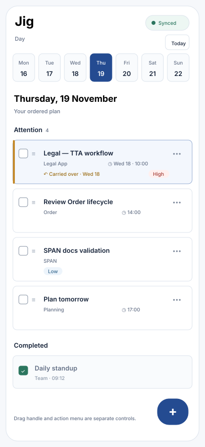

# Jig — UI solution design and visual reference contract

**Status:** Proposed binding UX/UI realization v0.1, 2026-11-16. Visual references and functional screen structure are governed; final browser screenshots and usability certification are pending.
**Governing behavior:** [Planning workbench functional design](../requirements/planning-workbench.md), JIG-FR-01–20.
**Technical foundation:** [Technical solution](../architecture/technical-solution.md), especially Astryx/dnd-kit ownership, service feedback and Git status.
**Purpose:** Turn the accepted early mobile/day/week/editor mockups into a versioned interface baseline while distinguishing layout intent from noncanonical visual decoration.

## 1. Source mockups and governed reference assets

The original design exploration used the temporary product name **Day**. It established the correct interaction direction: date-first weekly calendar/board, selected-day focus, compact title-first tasks, optional context/priority/reminder, drag handles, one task editor and a small completed region. The product's name is **Jig**.

The current repository includes four **versioned SVG structural reconstructions** derived from the approved screenshot layouts. These are implementation guidance, not claims that the exact original PNGs have been copied to Git. They deliberately remove conflicting green/high-shadow styling and extra navigation in favor of the verified Order/Astryx Neutral approach.

| Governing artifact | Screen | Structural meaning |
|---|---|---|
|  | [Desktop weekly planner](reference/desktop-week.svg) | Primary seven-day Kanban date board and visible cross-column movement targets |
|  | [Desktop day view](reference/desktop-day.svg) | Today's ordered list, completed group and on-demand selected task details |
|  | [Mobile narrow day](reference/mobile-day.svg) | Compact date strip and single-day stack at narrow widths |
|  | [Mobile edit surface](reference/mobile-editor.svg) | One bounded task editor; explicit Save/Cancel and optional secondary fields |

### Original screenshot provenance

The original raster files inspected when this design was authored were:

| Original filename | SHA-256 | Screen mapping |
|---|---|---|
| `day_by_pontivus_weekly_planner.png` | `f7ec8d8a105fa232d21958a74c58df36061b043fe3cd62469ec0ed9f486a7119` | desktop-week |
| `day_planning_dashboard_jan_23.png` | `086dc27cda6b89e5db1a62ed582da316c373dbfb7177de932ee32c414d01ef7f` | desktop-day |
| `day_by_pontivus_planner.png` | `d0a9e2d0316dc950d44cf03220006676995213087a415f72af138b037ea8a270` | mobile-day |
| `day_task_editor_mockup.png` | `d1bbaaedd185060673f4bff146585d17b92e17d6a49745fef958ca9bf04e5ea1` | mobile-editor |

The original PNG bytes are **not** yet stored in the repository; their hashes and corresponding governed SVG reconstructions are recorded here so the sources can be verified and imported later if desired. Do not substitute an unrelated stock image or relabel the originals as Jig production screenshots. The versioned SVG files define the current reviewed **structural** baseline; pixel-perfect final rendering must be certified from the running Astryx UI.

## 2. Information architecture

The initial desktop IA has exactly **Week**, **Today** (single selected day), **History**, and **Settings** as meaningful destinations. A separate **Board** destination is redundant: Week already is the dated Kanban board. The original mockups' Plan/Day/Board duplicates are not required screens.

- **Week** is the default productive surface: Monday–Sunday buckets, current/selected date emphasis, per-day ordered outstanding tasks, quick-add scoped to each date and cross-day drop targets. Long days scroll without losing date headings.
- **Today/Day** is a focused selected date with the same authoritative Task identity and position, a compact Completed group, and on-demand task detail. “Today” navigation selects the current local civil date; changing selection never reschedules tasks.
- **History** is a lightweight dated list grouped by actual completion date, not a dashboard. Completed items may also be viewed under their originally scheduled date.
- **Settings** exposes theme, configured repository path (read-only unless explicit migration), service/autosync health, remote connection, and diagnostic/retry actions. It does not expose Order projects or developer tooling.
- **No separately persisted boards, projects or queues.** Context is a short optional Task label and may be displayed or used as a filter, not an independent domain.

### Onboarding and installed lifecycle

The app's very first interaction is the **one-script installer** described in [Technical solution §3.1](../architecture/technical-solution.md). The script selects and validates the personal Git repository and configures the `jig` command + local background service. The user then opens the existing service with `jig` and immediately reaches Week or Today. There is **no repeated onboarding wizard on every run**.

A compact, always-available status control must truthfully distinguish:
- **Saved locally / Synced:** latest local edits committed to SQLite and Jig's Git ref has reached the configured remote.
- **Sync pending / Retrying:** local data safe, export or network transfer outstanding.
- **Local only:** no Git remote assigned; local DB and local Jig Git commits work.
- **Sync blocked:** divergence, invalid imported data, credentials or unsafe branch state. This is durable and actionable, not toast-only.

The UI must not present an ordinary local edit as remote-synchronized until remote push/adoption has actually succeeded. A failed local save is a different, workflow-critical state and is displayed near the edited task.

## 3. Visual language

Use the **published Astryx 0.7.13 core and Neutral theme** pinned with Order's verified baseline. Public semantic tokens own background/surface/border/text/accent, spacing, typography, focus and control states. Reuse existing foundation components rather than copying Order's private Workbench wrappers or styling internal Astryx selectors.

Visual rules:
1. **Compact, low-chrome and scan-oriented.** Prefer list/row structure with subtle boundaries to decorative card stacks; no gratuitous shadows/gradients.
2. **Dates and task titles first.** Priority is secondary: default Normal requires no loud badge; High/Low remain explicit but restrained. Reminders are labeled with a time and are not mistaken for event/time allocations.
3. **One primary action per active surface.** Quick Add is prominent at week level. A task detail editor has a single Save control. Completion uses an independently accessible checkbox/command.
4. **Clear current date and visible focus.** Selection/current, hover, focus, and save status remain semantically distinguishable without color alone.
5. **Theme parity.** System/Light/Dark preference may be exposed where the installed Astryx package supports it; never create a separate per-feature theme palette.
6. **Mobile-first semantics, desktop-first completeness.** Layout may recompose, but no Task value, selected date or pending form draft changes as a side effect of a breakpoint.
7. **SVGs are not final color/typography tokens.** Their wording and geometry are reviewable. Color and final measure must follow the pinned Astryx foundation and successful browser visual review.

## 4. Screen specifications

### 4.1 Desktop Week

Header: “Week of [date range]”, previous/next controls, Today shortcut, optional lightweight context filter, Quick Add. The week has seven calendar-date columns using stable local civil dates (Monday-start). Each date has title/date, outstanding count, ordered task rows, a date-specific Add task entry and a visible droppable region even when empty.

Task row: one completion control, title, optional context, exceptional priority marker, optional reminder time, drag handle, and a clear open/edit affordance; no fixed time slot, duration, status progression or nested subtask view. A current selected date is indicated in header and border; a selected Task can open editor/detail without changing its relative order.

Dnd-kit owns sortable IDs, pointer/touch sensors and drop targets; Astryx owns row appearance. A dragged Task moves to the **exact destination/date/position** where dropped, not a priority-based recalculation. Cancellation restores the prior view. Save failure restores/marks pending the committed order visibly.

The original mockup's additional Board link, excessive Normal badges, green cards and weekly progress metrics are **not MVP authority**; omit them unless separately designed after functional validation.

### 4.2 Desktop Day

A date strip permits switching selected days. Planned lists outstanding tasks in durable position order. Completed is compact and separately expandable. An optional right-hand inspector shows the selected Task, title, context, priority, reminder, reference, note and actions to complete/reopen, edit or move date; no Order lifecycle artifacts or project detail copies.

Day view and Week view query the **same Task**; opening the inspector does not create a second editable Task object. Preserve position changes and reload state. A due reminder may appear in an Astryx toast, not as a new work item.

### 4.3 Mobile narrow Day

At narrow widths the week board becomes a horizontal seven-date strip plus one day's list. Preserve prominent title-first tasks, touch-sized checkbox and action targets, drag handles where touch reordering is supported and a non-drag move-to-date command. A persistent Quick Add target may move to the thumb-reachable region, but must not obscure the last item or reminder feedback.

Desktop MVP requires responsive semantic continuity and basic mobile-sized layout validation. It does **not** require installation as a self-contained phone app, native Git commands or background push notifications.

### 4.4 Mobile/editor composition

Task creation defaults to **title only** and the initiating date; no forced priority, reminder, time estimate or context. Editing uses one bounded Astryx Dialog/compatible responsive treatment with Title, Date, optional Context, optional Priority, optional Reminder Time, optional Reference and optional short Notes. Optional fields are initially subordinate; no advanced project form.

Use explicit Save/Cancel, persistent form errors on invalid data or server refusal, and preserve the active draft while the screen is reflowed or while a user inspects another date unless they explicitly confirm discarding edits. Date editing applies priority-guided insertion, whereas a drag drop uses the exact drop index. Changing priority does not rearrange the task.

## 5. Interaction and component ownership

| UI concern | Canonical owner |
|---|---|
| Shell, navigation, buttons, icon buttons, lists, labels, fields, dialog/drawer, calendar input, time input, toasts, semantic theme | Astryx published primitives |
| Sortable rows, drop zones, drag overlays, keyboard drag, pointer/touch gesture lifecycle | @dnd-kit/react only; do not activate Astryx List createReorderable on the same row |
| Week/date bucket composition, mobile strip, empty-date state, completed groups, task editor composition | Small Jig React composition |
| Scheduled date, ordering, initial priority placement, complete/reopen, task identity | Pure Jig planning core |
| Task reads/writes, Git state and remote status | Bun service with SQLite and dedicated Jig branch/worktree |
| Reminder due eligibility and toast presentation while browser is open | Browser-side timer + Astryx useToast; no background sender |

Keyboard alternatives **Move up**, **Move down**, **Move to date** invoke the same canonical Task operation as a drag. The drag handle must not swallow checkbox clicks, link navigation or editor opening. Avoid duplicate focus stops on the ListItem's clickable layer and nested controls; verify Astryx + dnd-kit with actual Playwright browser interaction.

## 6. Required browser/UX validation

| Case | Acceptance |
|---|---|
| Week scanning | Seven readable dates with distinct current/selected state and no horizontal overflow of individual task titles |
| Title-only creation | Adds into originating date in a minimum interaction |
| Priority default | Newly created task inserted by functional priority law, existing manual sequence untouched |
| Same-day drag | Exact chosen position persists after reload |
| Cross-day drag | Destination and position persist, source loses item, empty date works |
| Midday edits | Metadata/priority edits preserve manual ordering |
| Completion | Task leaves active list, keeps scheduled date and actual completion time/history |
| Responsive reflow | No loss of selected date, task, open editor draft or outstanding modifications |
| Keyboard and touch | No hover-only essential actions; non-drag alternatives and visible focus |
| Reminder | Due while open produces dismissible toast; no claim when browser closed |
| Local save failure | User sees specific unresolved error, not fake save success |
| Auto-sync lifecycle | Service can save/sync with browser closed; header/settings convey local/sync/pending/blocked truth |
| Offline use | Editing remains available, Git retries later without blocking |
| Theme parity | Equivalent hierarchy and contrast in system/light/dark if exposed |
| Resource discipline | Responsive reopen and low-idle service measured as part of installer certification |

Use actual approved Astryx and dnd-kit versions in Playwright for final UI evidence; these SVGs alone do not certify pixel fidelity or interaction. Archive browser screenshots from these tests in the repository when implementation begins; they supersede early concept art only after review.

## 7. Design change control

The versioned SVGs in `docs/design/reference/` are the current baseline for layout and content hierarchy. When an interaction changes, update this document and the relevant SVG together. If only runtime appearance changes to correct Astryx component parity, update implementation and browser evidence without inventing a second canonical visual-token contract.

Do not refer to the previous Day branding as a current product identity. Do not use project-specific task details as content that Jig must store; they exist only as illustrative samples. An implementation plan must link to this document and to [Technical solution](../architecture/technical-solution.md).
