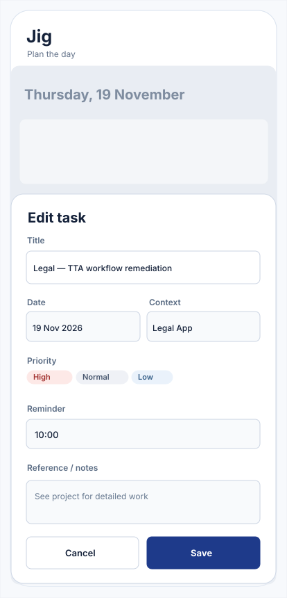
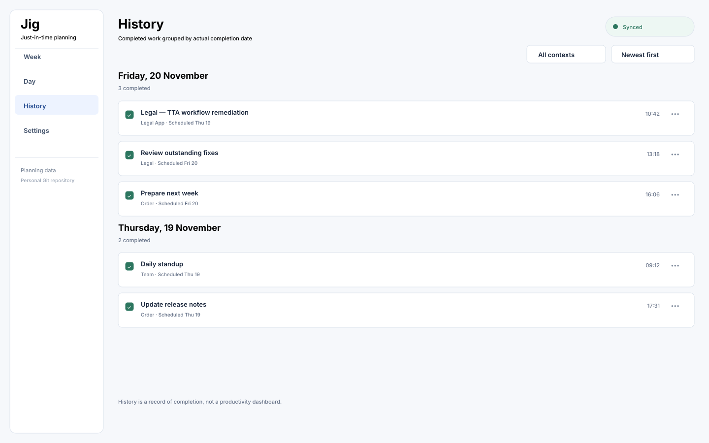
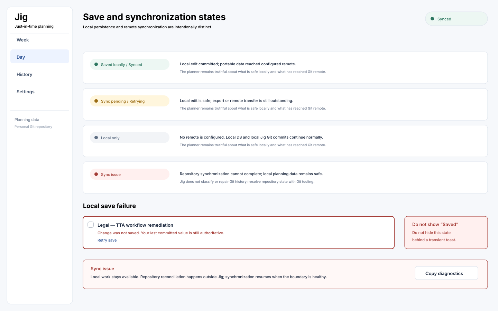

# Jig — UI solution design and visual reference contract

**Status:** Binding v1.0.4 UX/UI realization v0.8, 2026-11-17. The v1.0.3 single responsive Planner remains, with v1.0.4 corrections for distinct state color semantics, exact-current-day indication, working card-body drag, stable header height, outside-click dismissal, complete Task menus and one directly editable Task workspace.
**Governing behavior:** [Planning workbench functional design](../requirements/planning-workbench.md), JIG-103-FR-01–17, JIG-104-FR-01–09 and JIG-FR-01–22.
**Technical foundation:** [Technical solution](../architecture/technical-solution.md), especially Astryx/dnd-kit ownership, service feedback and Git status. **Brand/theme authority:** [Brand and theme system](brand-and-theme.md).
**Purpose:** Govern the approved v1.0.3 Planner composition and preserve useful earlier visual evidence without allowing superseded Day/Week/sidebar structures to remain authoritative.

## 1. Source mockups and governed reference assets

The early design exploration used the temporary product name **Day** and separate Day/Week destinations. Those assets remain provenance only. The v1.0.3 review supersedes that navigation model with one responsive Planner.

The binding structural references for this batch are:

| Governing artifact | Screen | Structural meaning |
|---|---|---|
|  | [Desktop Planner](reference/desktop-planner-v1.0.3.svg) | No sidebar; Jig home at left; page-centered week range above grouped Previous/Today/Next controls; Add task/History/Settings/sync at right; seven fluid date tracks |
|  | [Mobile/narrow Planner](reference/mobile-planner-v1.0.3.svg) | Jig/sync/hamburger application row, centered week range + grouped week controls, seven-date strip, selected-date Task list |
|  | [Narrow Task workspace](reference/mobile-editor.svg) | BottomSheet Task workspace; permanent Delete confirmation remains separate |
|  | [Desktop history](reference/desktop-history.svg) | Lightweight completion history; uses the same top application navigation |
|  | [Desktop settings/sync](reference/desktop-settings-sync.svg) | Appearance, notification and operational status/settings |
|  | [Save/sync states](reference/sync-failure-states.svg) | Honest local-save and repository synchronization feedback |

The older `desktop-week.svg`, `desktop-week-task-drawer.svg`, `desktop-day.svg` and `mobile-day.svg` are historical design inputs after this revision. They must not be used to reintroduce a sidebar, Day/Week destinations, a Day completed section, a split date-navigation model, or a right-side mobile Drawer.

The original raster provenance recorded in repository history remains useful for traceability, but those images are not production screenshots or current structural authority.

## 2. Information architecture

Jig has one primary destination: **Planner**. Planner is implicit Home and therefore does not appear as a redundant navigation item.

The only secondary destinations are **History** and **Settings**.

- Clicking the Jig product mark/wordmark returns to Planner.
- Desktop exposes History and Settings directly in the right side of the global header.
- Narrow/mobile exposes the same two destinations through a compact hamburger menu/popover.
- There is no desktop SideNav, mobile navigation drawer, separate Day destination, separate Week destination, or Board destination.
- Today is a temporal shortcut inside Planner, not a destination.

Planner owns one `displayed week + selected date` presentation state. Desktop renders all seven outstanding date sequences at once. Narrow/mobile renders the same seven dates as a strip and shows only the selected date's outstanding sequence. Completed Tasks are absent from Planner and live in History.

### Onboarding and installed lifecycle

The app's first interaction remains the one-script installer described in the technical solution. After installation, `jig` opens the Planner on the current local date/current week. No repeated onboarding wizard is introduced.

A compact always-available synchronization indicator truthfully distinguishes synchronized, pending/retrying, local-only and sync-issue outcomes. The UI never exposes Git topology as Planner state. `Local only` uses a restrained success/green cue because local persistence is healthy while retaining the explicit label; `Synced` is the distinct remote-synchronized outcome. Unknown status alone is neutral grey.

## 3. Visual language

Use the published **Astryx 0.7.13 core** with Jig's canonical theme defined by [Brand and theme system](brand-and-theme.md). `jigTheme` extends Astryx Neutral so Astryx continues to own spacing, typography mechanics, component structure and semantic status families, while Jig owns the product palette and its Light/Dark role mapping.

Theme ownership is singular:

- `ui/src/theme.css` owns raw Jig Ink/Amber/Paper primitives;
- `ui/src/jig-theme.source.ts` is the only authored semantic mapping from those primitives into Astryx roles and extends `@astryxdesign/theme-neutral/built`;
- pinned `@astryxdesign/cli@0.7.13` compiles that source with `astryx theme build` into committed `ui/src/jig.js`, `ui/src/jig.css` and declarations; generated artifacts are compiler-owned and are never hand-edited;
- `ui/src/styles.css` imports the generated theme CSS and styles only Jig-owned product composition using public Astryx tokens;
- `ui/src/app.tsx` imports the generated `jigTheme` from `ui/src/jig.js` and mounts the one root Jig Theme owner;
- CI runs `theme build --check` so source/artifact drift is a release failure.

### 3.1 UI implementation authority

The visual reference does **not** authorize bypassing the component architecture. Implementation order is mandatory:

1. this UI solution and the governed SVGs define product structure, hierarchy, density and genuine structural dimensions;
2. pinned Astryx public APIs define application shell, navigation, responsive shell behavior, list/field/button/link/drawer/dialog anatomy, spacing mechanics and semantic styling;
3. Jig React composition supplies only product-specific structures such as the three-zone Planner header, seven dated Planner buckets, narrow date strip/list, shared Task workspace and Settings information grouping;
4. Jig CSS supplies only the remaining Jig-owned geometry and consumes public Astryx tokens;
5. browser geometry assertions and screenshots verify the implementation; they do not justify private overrides or compensating layout rules.

The pinned Astryx `AppShell` is the application frame, but v1.0.3 deliberately omits `sideNav` and disables the AppShell automatic mobile drawer. Use the `topNav` slot plus public Astryx Button/IconButton/DropdownMenu or Popover primitives for the approved Jig header. Do not place another complete shell inside AppShell or duplicate the main landmark.

The desktop header is one Jig-owned three-zone composition: Jig Home at left, the centered Planner temporal centerpiece, and Add task/History/Settings/synchronization state at right. The center must remain optically/page centered despite unequal side-zone widths. History and Settings use semantic icons plus accessible labels; there is no SideNav.

CSS may set the governed product-level dimensions needed to reproduce the structural references, but must not reshape Astryx internals. No Jig rule may rely on an undocumented/private Astryx selector, DOM child structure, StyleX detail or private custom property. Do not use an application-owned high-priority cascade layer, `!important`, or selector escalation to win against the library. The application must also not synthesize Astryx compiler/runtime markers such as `__built` or manually replace the documented theme-build pipeline; those belong only to Astryx-generated artifacts. If a public Astryx primitive cannot realize a governed requirement, document that incompatibility and use the smallest Jig-owned semantic composition built from public Astryx leaves/tokens.

Visual rules:
1. **Compact, low-chrome and scan-oriented.** Prefer list/row structure with subtle boundaries to decorative card stacks; no gratuitous shadows/gradients.
2. **Dates and task titles first.** Priority is secondary: default Normal requires no loud badge; High/Low remain explicit but restrained. Reminders are labeled with a time and are not mistaken for event/time allocations.
3. **One primary action per active surface.** Quick Add is prominent at week level. The Task workspace has a single Save or Move action in its active edit mode. Completion uses an independently accessible checkbox/command.
4. **Distinct state vocabulary.** Current day, selected Task, drag target and priority are different semantics and must not collapse onto one Amber fill. Current day is an exact-date, subtle neutral border/header treatment. Selected Task uses a subtle information/selection surface. Drag target uses transient accent treatment. Priority remains a narrow leading cue: High error, Normal quiet neutral, Low calm/success-family.
5. **Brand restraint.** Ink and Paper own structure/surfaces; Amber is selective identity/action/drag emphasis rather than the generic color for every active state. Semantic info/success/warning/error remain Astryx status colors and are never replaced with brand Amber.
6. **Theme parity.** System/Light/Dark are mandatory. System follows the browser/platform preference and explicit Light/Dark overrides it locally. The same structure, hierarchy, spacing, focus, selection, priority, completion, save and sync semantics must remain clear in both themes without relying on color alone.
7. **Mobile-first semantics, desktop-first completeness.** Layout may recompose, but no Task value, selected date or pending form draft changes as a side effect of a breakpoint.
8. **Reference SVGs remain structural.** Their wording, geometry and density are reviewable, but the final production palette is the canonical Jig theme. No duplicate dark-mode structural mockup set is required.

## 4. Screen specifications

### 4.1 Desktop Planner

The approved desktop composition is the v1.0.3 reference.

**Header:** one compact full-width application header with three zones.

- **Left:** Jig product mark/home affordance.
- **Center:** active week range on the first line, for example **16–22 Nov 2026**. Directly beneath it is a grouped **Previous week chevron · Today · Next week chevron** row. The range never sits between the arrows.
- **Right:** **Add task**, **History**, **Settings**, compact synchronization state.

The temporal centerpiece is centered on the page, not merely centered in the leftover space between left/right controls.

The week range uses compact formatting without “Week of” or a separate month title. Previous/Next shift by exactly seven days while preserving selected weekday; Today selects the current local date/current week.

The board contains seven equal Monday–Sunday tracks. Each track has a 160px minimum and expands with the available desktop canvas. Date headers such as `Thu 19` are the desktop date selector.

Desktop does not persistently color the whole selected-date column. The exact current local civil date alone receives the subtle current-day border/header treatment; the same weekday in another displayed week does not. Selected Task uses its own subtle card selection treatment. Drag-over has a separate transient treatment. Do not conflate these states.

Task cards are compact and title-first. A thin leading color/accent may encode priority for scanning, but color is not the only priority signal and Normal remains visually quiet.

Clicking a Task opens the full editable Task form directly in the non-blocking right workspace without moving it. There is no separate read-only details step and no Edit indirection. The workspace overlays the board and never narrows/reflows the seven tracks. Clicking blank Planner/History content dismisses the workspace; clicking another Task retargets it. Global Add task originates from the selected date; column Add task originates from that column and opens the same full form.

Remove descriptive/meta copy. The desktop interface must not display phrases such as “Week of”, “full available canvas”, “selected date view”, “Today is a shortcut”, or similar explanatory design text.

### 4.2 Desktop History and Settings

History and Settings retain the same global application-header language. Their active destination is clear without reintroducing a sidebar.

On History, selecting a completed Task opens the same right-side Task workspace while History remains active. Settings has no Planner week navigator because week controls operate only on Planner state. Clicking Jig returns to Planner and preserves the session's Planner date/week state.

### 4.3 Narrow/mobile Planner

Below the technical 76rem semantic breakpoint, render a deliberate narrow Planner composition rather than hiding desktop pieces with CSS.

The top hierarchy is:

1. Jig product mark/home on the left; compact sync state plus hamburger on the right;
2. centered active week range;
3. grouped Previous/Today/Next controls immediately beneath the range;
4. seven-date horizontal strip;
5. compact selected-date heading and optional Task count;
6. selected-date outstanding Task list;
7. prominent Add task touch action outside the constrained header.

Do not render `Day`, `Week`, `Attention`, `Your ordered plan`, `selected date view`, or other labels that restate the visible hierarchy.

The hamburger opens a compact menu/popover containing only History and Settings. It is not a drawer.

Task view/create/edit uses a BottomSheet rising from the bottom. Create initially asks only for title and inherits the selected/originating date. Edit exposes optional fields. Delete confirmation remains the sole blocking Task dialog.

When narrow drag is absent, Move up/Move down provides touch ordering within the date and Edit date provides cross-date rescheduling.

### 4.4 Shared Task workspace

There is one Task workspace with two open semantic states: **existing Task draft** and **create draft**. Both render the same editable field hierarchy through a right-side non-modal Drawer on desktop and BottomSheet on narrow/mobile. There is no read-only view mode and no Move-to-date mode.

The field hierarchy is always Title, Date, Context, Priority, Reminder, Reference, Notes. Add inherits date/defaults but shows the same fields. Save/Cancel and persistent validation errors are explicit. Responsive reflow preserves the draft. Permanent Delete uses AlertDialog confirmation.

## 5. Interaction and component ownership

| UI concern | Canonical owner |
|---|---|
| Application frame | Astryx AppShell with no SideNav and no automatic mobile drawer |
| Global/header controls | Astryx Button/IconButton plus DropdownMenu or Popover mechanics; Jig owns only three-zone/centered geometry |
| Planner temporal state | Jig pure presentation state: displayed week start + selected date |
| Lists, labels, fields, alerts, toasts, semantic theme | Astryx published primitives |
| Desktop Task workspace | Astryx non-modal right Drawer |
| Narrow Task workspace | Astryx BottomSheet rising from the bottom |
| Sortable rows/drop zones | @dnd-kit/react only |
| Planner seven-track composition, narrow date strip/list, Task workspace content | small Jig React composition |
| Scheduled date/order/rollover/complete/reopen/delete/identity | pure Jig planning core |
| Task reads/writes and repository synchronization state | Bun service + SQLite + repository adapter |

Jig CSS owns only the page-centered header grid, seven Planner tracks, narrow composition, drag state and restrained Task priority accent. It consumes public Astryx tokens/roles and must not target private component internals.

Keyboard/touch alternatives Move up and Move down call the same canonical order mutation. Date editing calls the same canonical date-change operation. The drag handle must not swallow completion, Task selection, link or menu activation.

## 6. Required browser/UX validation

| Case | Acceptance |
|---|---|
| Header composition | Jig Home left; week range truly page-centered above grouped Previous/Today/Next; Add task/History/Settings/sync right; no sidebar; outer header height does not change across Planner/History/Settings |
| Week navigation | Previous/Next shift displayed week and selected date exactly seven days; Today restores current date/current week; no Task mutation |
| Week scanning | Seven readable date tracks, >=160px each in desktop mode, fluid expansion; only exact today gets current-day treatment; selected Task, priority and drag target remain visually distinct |
| Unified creation | Global Add uses selected date; column/local Add uses originating date; the full canonical Task form is visible immediately with inherited defaults and no later Edit step required |
| Task workspace | Click selects and opens the directly editable full Task form without changing date/order/destination; no second Edit click exists |
| Workspace geometry | Desktop Drawer overlays without narrowing board; narrow BottomSheet rises from bottom |
| Responsive continuity | displayed week, selected date/task, workspace mode and unsaved draft survive Drawer↔BottomSheet change |
| Mobile header | Jig/sync/hamburger first row; centered week range + grouped controls; seven-date strip; hamburger menu has only History/Settings and is not a drawer |
| Copy discipline | no obsolete Day/Week labels or explanatory/meta copy |
| Same/cross-day drag | exact chosen position/date persists; empty destination works |
| Narrow ordering | Move up/down works without introducing a second order representation |
| Completion/History | completing removes from Planner; History remains inspectable/reopenable |
| Daily rollover | same canonical Task appears in current-date Planner bucket on desktop and narrow |
| Delete | cancel is no-op; confirm permanently removes Task; Git round trip preserves absence |
| Theme/color | System/Light/Dark retain hierarchy; priority accent remains readable without relying on color alone |
| Save/sync feedback | local failure is explicit; `Local only` is a restrained healthy/success cue with explicit label; `Synced` remains distinct; pending/retrying warning, sync issue error, unknown neutral |

Final production evidence is the running Astryx UI in Playwright/browser screenshots. Reference SVGs govern structure, not pixel-perfect library anatomy.

## 7. Design change control

The v1.0.3 Planner references and this document supersede earlier Day/Week/sidebar structure. When an interaction hierarchy changes, update this document and the corresponding v1.0.3 reference SVG together.

Production color/logo/theme behavior remains governed by [Brand and theme system](brand-and-theme.md). The accepted priority color cue is a restrained scanning aid, not a second status system and never the sole semantic carrier.

Implementation plans must link to this document, [Planning workbench functional design](../requirements/planning-workbench.md), and [Technical solution](../architecture/technical-solution.md). No implementation may cite historical Day/Week reference assets to reintroduce removed destinations, SideNav, a mobile drawer or a mobile right-side Drawer.
