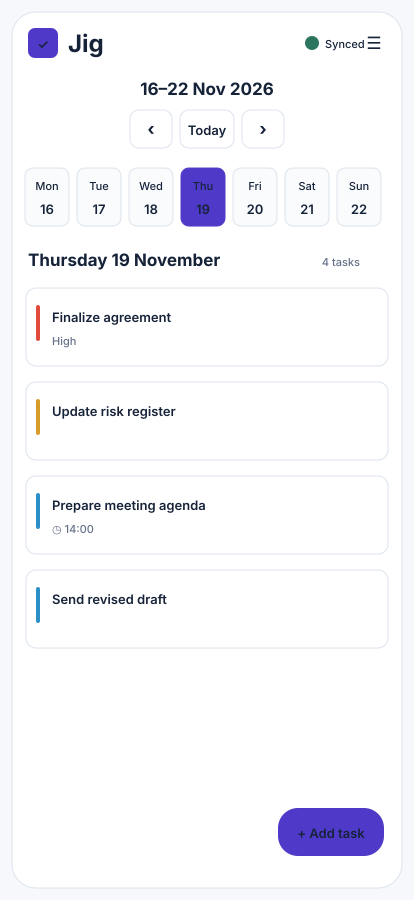

# Jig — UI solution design and visual reference contract

**Status:** Binding v1.0.5 UX/UI realization v0.12, 2026-11-17. It preserves the v1.0.4 single-Planner structure while correcting published v1.0.4 defects in drag stability, required narrow/mobile drag, compact header density, semantic icon/menu normalization, Task-card surface contrast and responsive rendering parity.
**Governing behavior:** [Planning workbench functional design](../requirements/planning-workbench.md), JIG-103-FR-01–17, JIG-104-FR-01–12 and JIG-FR-01–22.
**Technical foundation:** [Technical solution](../architecture/technical-solution.md), especially Astryx/dnd-kit ownership, service feedback and Git status. **Brand/theme authority:** [Brand and theme system](brand-and-theme.md).
**Purpose:** Govern the approved v1.0.3 Planner composition and preserve useful earlier visual evidence without allowing superseded Day/Week/sidebar structures to remain authoritative.

## 1. Source mockups and governed reference assets

The early design exploration used the temporary product name **Day** and separate Day/Week destinations. Those assets remain provenance only. The v1.0.3 review supersedes that navigation model with one responsive Planner.

The v1.0.3 assets below are retained as historical structural baselines where explicitly noted. The binding v1.0.4 interaction and visual authority is this document together with the functional design and brand/theme contract:

| Governing artifact | Screen | Structural meaning |
|---|---|---|
|  | [Desktop Planner](reference/desktop-planner-v1.0.3.svg) | Historical structural baseline: no sidebar; Jig home at left; page-centered week range above grouped Previous/Today/Next controls; right-side actions/navigation; seven fluid date tracks. v1.0.4 supersedes its heavier chrome and adds explicit Planner navigation. |
|  | [Mobile/narrow Planner](reference/mobile-planner-v1.0.3.svg) | Historical v1.0.3 narrow composition only. v1.0.4 supersedes its selected-date strip/list with seven vertically stacked dated sections; the asset must not be used as authority for day selection. |
|  | [Narrow Task workspace](reference/mobile-editor.svg) | BottomSheet Task workspace; permanent Delete confirmation remains separate |
|  | [Desktop history](reference/desktop-history.svg) | Lightweight completion history; uses the same top application navigation |
|  | [Desktop settings/sync](reference/desktop-settings-sync.svg) | Appearance, notification and operational status/settings |
|  | [Save/sync states](reference/sync-failure-states.svg) | Honest local-save and repository synchronization feedback |

The older `desktop-week.svg`, `desktop-week-task-drawer.svg`, `desktop-day.svg` and `mobile-day.svg` are historical design inputs after this revision. They must not be used to reintroduce a sidebar, Day/Week destinations, a Day completed section, a split date-navigation model, or a right-side mobile Drawer.

The original raster provenance recorded in repository history remains useful for traceability, but those images are not production screenshots or current structural authority.

## 2. Information architecture

Jig has one primary planning destination: **Planner**. Planner remains the default/Home destination and is also shown explicitly in the desktop right-side navigation beside History and Settings so destination state is immediately legible. The Jig mark remains an additional Home affordance. Narrow/mobile keeps Planner as the current/Home surface while the compact menu contains only History and Settings.

The only secondary destinations are **History** and **Settings**.

- Clicking the Jig product mark/wordmark returns to Planner.
- Desktop exposes History and Settings directly in the right side of the global header.
- Narrow/mobile exposes the same two destinations through a compact hamburger menu/popover.
- There is no desktop SideNav, mobile navigation drawer, separate Day destination, separate Week destination, or Board destination.
- Today is a temporal shortcut inside Planner, not a destination.

Planner owns one temporal presentation state: the displayed week. Desktop renders all seven outstanding date sequences as columns. Narrow/mobile renders the same seven sequences as vertically stacked dated sections. There is no selected-day state or selected-day subview. Completed Tasks are absent from Planner and live in History.

### Onboarding and installed lifecycle

The app's first interaction remains the one-script installer described in the technical solution. After installation, `jig` opens the Planner on the current local date/current week. No repeated onboarding wizard is introduced.

A compact always-available synchronization indicator truthfully distinguishes synchronized, pending/retrying, local-only and sync-issue outcomes. The UI never exposes Git topology as Planner state. `Local only` uses a restrained success/green cue because local persistence is healthy while retaining the explicit label; `Synced` is the distinct remote-synchronized outcome. Unknown status alone is neutral grey.

## 3. Visual language

Use the published **Astryx 0.7.13 core** with Jig's canonical theme defined by [Brand and theme system](brand-and-theme.md). `jigTheme` extends Astryx Neutral so Astryx continues to own spacing, typography mechanics, component structure and semantic status families, while Jig owns the product palette and its Light/Dark role mapping.

Theme ownership is singular:

- `ui/src/theme.css` owns raw Jig Ink/Amber/Paper primitives;
- `ui/src/jig-theme.source.ts` is the only authored semantic mapping from those primitives into Astryx roles and extends `@astryxdesign/theme-neutral/built`;
- pinned `@astryxdesign/cli@0.7.13` compiles that source with `astryx theme build` into committed `ui/src/jig.js`, `ui/src/jig.css` and declarations; generated artifacts are compiler-owned and are never hand-edited;
- `ui/src/styles.css` imports the generated theme CSS and styles only Jig-owned product composition using public Astryx tokens;
- `ui/src/app.tsx` imports the generated `jigTheme` from `ui/src/jig.js` and mounts the one root Jig Theme owner;
- CI runs `theme build --check` so source/artifact drift is a release failure.

### 3.1 UI implementation authority

The visual reference does **not** authorize bypassing the component architecture. Implementation order is mandatory:

1. this UI solution and the governed SVGs define product structure, hierarchy, density and genuine structural dimensions;
2. pinned Astryx public APIs define application shell, navigation, responsive shell behavior, list/field/button/link/drawer/dialog anatomy, spacing mechanics and semantic styling;
3. Jig React composition supplies only product-specific structures such as the three-zone Planner header, seven dated Planner buckets, narrow seven-section stack, shared Task workspace and Settings information grouping;
4. Jig CSS supplies only the remaining Jig-owned geometry and consumes public Astryx tokens;
5. browser geometry assertions and screenshots verify the implementation; they do not justify private overrides or compensating layout rules.

The pinned Astryx `AppShell` is the application frame, but v1.0.3 deliberately omits `sideNav` and disables the AppShell automatic mobile drawer. Use the `topNav` slot plus public Astryx Button/IconButton/DropdownMenu or Popover primitives for the approved Jig header. Do not place another complete shell inside AppShell or duplicate the main landmark.

The desktop header is one Jig-owned three-zone composition: Jig Home at left, the centered Planner temporal centerpiece, and Add task + adjacent Planner/History/Settings navigation + synchronization state at right. The center must remain optically/page centered despite unequal side-zone widths. History and Settings use semantic icons plus accessible labels; there is no SideNav.

CSS may set the governed product-level dimensions needed to reproduce the structural references, but must not reshape Astryx internals. No Jig rule may rely on an undocumented/private Astryx selector, DOM child structure, StyleX detail or private custom property. Do not use an application-owned high-priority cascade layer, `!important`, or selector escalation to win against the library. The application must also not synthesize Astryx compiler/runtime markers such as `__built` or manually replace the documented theme-build pipeline; those belong only to Astryx-generated artifacts. If a public Astryx primitive cannot realize a governed requirement, document that incompatibility and use the smallest Jig-owned semantic composition built from public Astryx leaves/tokens.

Visual rules:
1. **Compact, low-chrome and scan-oriented.** The week is an open canvas, not seven boxed panels. Prefer whitespace, typography and at most hairline separators to heavy outlines. Task cards remain discrete interactive units but use restrained borders/shadows. Avoid nested frames, thick lane borders, gratuitous shadows/gradients and repeated decorative lines.
2. **Dates and task titles first.** Priority is secondary: default Normal requires no loud badge; High/Low remain explicit but restrained. Reminders are labeled with a time and are not mistaken for event/time allocations.
3. **One primary mutation per active form.** Add task is prominent at Planner level. The editable Task workspace has Save as its primary form action; completion/reopen and Delete remain independent Task commands rather than alternate form modes.
4. **Distinct state vocabulary.** Current day, selected Task, drag target and priority are different semantics and must not collapse onto one brand/neutral family. Current day is an exact-date, subtle teal border/header treatment. Selected Task uses a subtle info-blue surface/border. Drag target uses transient Amber. Priority remains a narrow leading cue: High error/red, Normal quiet neutral, Low calm/success-green.
5. **Brand restraint.** Ink and Paper own structure/surfaces; Amber is selective identity/action/drag emphasis rather than the generic color for every active state. Semantic info/success/warning/error remain Astryx status colors and are never replaced with brand Amber.

#### v1.0.4 state appearance matrix

**Color authority:** the exact component/state colors, Light/Dark resolved values, semantic aliases, button variants, hover/pressed/focus/disabled behavior and prohibited substitutions are governed by [Brand and theme §§6.2–6.4](brand-and-theme.md#62-canonical-jig-product-semantic-tokens). This table summarizes product meaning only; it does not authorize alternative colors.

| UI state | Appearance contract |
|---|---|
| Desktop exact current day | subtle teal column/header border + teal date typography; no lane fill |
| Planner selected day | **none** — day selection is not a product state in v1.0.4 |
| Selected Task | subtle info-blue muted surface + info-blue border; no Amber/teal selection fill |
| Task High priority | narrow error/red leading cue; explicit High label where shown |
| Task Normal priority | quiet Ink/neutral leading cue; no loud badge |
| Task Low priority | narrow calm success/green leading cue; explicit Low label where shown |
| Drag source/target | transient Amber/accent outline/overlay only during direct manipulation |
| Keyboard focus | Amber focus ring only; does not change the persistent state color |
| Active History/Settings destination | quiet neutral active treatment, not the selected-Task or drag-target treatment |
| Local only / Synced | restrained success family, distinguished by label |
| Pending/retrying | warning family |
| Sync/save error | error family |
| Unknown status | neutral grey |

6. **Theme parity.** System/Light/Dark are mandatory. System follows the browser/platform preference and explicit Light/Dark overrides it locally. The same structure, hierarchy, spacing, focus, selection, priority, completion, save and sync semantics must remain clear in both themes without relying on color alone.
7. **Mobile-first semantics, desktop-first completeness.** Layout may recompose, but no Task value, displayed week or pending form draft changes as a side effect of a breakpoint.
8. **Reference SVGs remain structural.** Their wording, geometry and density are reviewable, but the final production palette is the canonical Jig theme. No duplicate dark-mode structural mockup set is required.

## 4. Screen specifications

### 4.1 Desktop Planner

The approved desktop composition is the v1.0.3 reference.

**Header:** one compact full-width application header with three zones.

- **Left:** Jig product mark/home affordance.
- **Center:** active week range on the first line, for example **16–22 Nov 2026**. Directly beneath it is a grouped **Previous week chevron · Today · Next week chevron** row. The range never sits between the arrows.
- **Right:** **Add task**, adjacent **Planner · History · Settings** navigation, compact synchronization state. Planner is visibly active on the Planner surface.

The temporal centerpiece is centered on the page, not merely centered in the leftover space between left/right controls.

The week range uses compact formatting without “Week of” or a separate month title. Previous/Next shift the displayed week by exactly seven days. Today returns to the week containing the current local date.

The board contains seven equal-width Monday–Sunday tracks. Each track has a 160px width minimum and expands with the available desktop canvas. Vertical height is content-driven, so lanes may end at different heights. The tracks are visually open: no lane cards, no thick outlines and no framed column containers. Use spacing and at most a subtle hairline divider between adjacent days. Date headers use full weekday names, for example `Thursday 19`; they are non-selectable date signifiers and contain a compact `+` immediately adjacent to the label for date-specific creation.

The exact current local civil date alone receives the subtle teal current-day border/header treatment; the same weekday in another displayed week does not. Selected Task uses its own subtle info-blue card selection treatment. Drag-over uses transient Amber. Priority uses red/neutral/green cues. Do not conflate these states.

Task cards are compact and title-first. They are the primary discrete surfaces inside the otherwise open week canvas. Use a restrained surface, thin border and minimal elevation only where needed for separation; avoid heavy outlines or nested chrome. Small semantic icons may identify reminder, context/reference, completion or other visible metadata states, while the title remains dominant. A thin leading color/accent may encode priority for scanning, but color is not the only priority signal and Normal remains visually quiet.

Clicking a Task opens the full editable Task form directly in the non-blocking right workspace without moving it. There is no separate read-only details step and no Edit indirection. The workspace overlays the board and never narrows/reflows the seven tracks. Clicking blank Planner/History content dismisses the workspace; clicking another Task retargets it. Global Add task derives its default date from the viewed week and the current local weekday; in the current week this is today. Per-date Add is the compact `+` in that date header and opens the same full form for that explicit date. The former full-width bottom-of-lane Add control does not exist.

Remove descriptive/meta copy. The desktop interface must not display phrases such as “Week of”, “full available canvas”, “selected date view”, “Today is a shortcut”, or similar explanatory design text.

### 4.2 Desktop History and Settings

Planner, History and Settings share the same global application-header language and adjacent desktop navigation group. The active destination is clear through the governed neutral active-navigation treatment without reintroducing a sidebar.

On History, selecting a completed Task opens the same right-side Task workspace while History remains active. Settings has no Planner week navigator because week controls operate only on Planner state. Clicking Jig returns to Planner and preserves the session's Planner date/week state.

### 4.3 Narrow/mobile Planner

Below the technical 76rem semantic breakpoint, render a deliberate narrow Planner composition rather than hiding desktop pieces with CSS.

The top hierarchy is:

1. Jig product mark/home on the left; compact sync state plus hamburger on the right;
2. centered active week range;
3. grouped Previous/Today/Next controls immediately beneath the range;
4. seven vertically stacked dated sections for the displayed week;
5. each section header shows the full weekday name + day number (for example `Thursday 19`) plus a compact `+`, followed by that date's outstanding Task list;
6. global Add task remains available as a week-context shortcut using the derived weekday-matching default date.

There is no horizontal date strip, selected-date heading, or selected-day Task subview.

Do not render `Day`, `Week`, `Attention`, `Your ordered plan`, `selected date view`, or other labels that restate the visible hierarchy.

The hamburger opens a compact menu/popover containing only History and Settings. It is not a drawer.

Task create/edit uses a BottomSheet rising from the bottom. Existing Tasks open directly into the full editable field surface. Add uses the same full field surface with its derived or explicit originating date and canonical defaults. Delete confirmation remains the sole blocking Task dialog.

Narrow/mobile supports the same direct card-body drag semantics as desktop using touch/pen/mouse input. Move up/Move down remains the non-drag accessibility alternative within the date, and Edit date remains the explicit non-drag cross-date rescheduling path.

### 4.3.1 v1.0.5 narrow/mobile parity correction

The v1.0.4 published narrow composition did not meet the intended parity standard. v1.0.5 makes the following presentation requirements explicit:

- **Same Task surface:** narrow/mobile Task cards use the same semantic Task-surface and border tokens as desktop. Responsive CSS may increase touch height/spacing but must not replace the Task surface with the page/section background.
- **Same direct manipulation:** outstanding Task cards are sortable on narrow/mobile. Touch drag uses the same body activator and canonical exact-position move semantics as desktop.
- **Normalized application controls:** the narrow application band uses the canonical complete Jig wordmark, compact sync state, semantic Add icon and semantic hamburger icon with one consistent icon size/hit-area system.
- **Normalized menu:** the hamburger opens the Astryx compact popover/menu with History and Settings only. Where the public menu API supports leading content, both items use the same semantic destination icon vocabulary as desktop and retain text labels. No legacy drawer, raw Unicode stand-ins or mixed icon styles are permitted.
- **Same Task metadata/action iconography:** reminder, reference/copy, completion, overflow and status meanings do not disappear or switch representation merely because the layout is narrow.
- **Same state vocabulary:** today, Task selection, priority, focus, drag and operational status use the same semantic aliases as desktop.
- **Same visual legibility:** card/canvas contrast must remain clearly visible in both Light and Dark. The mobile renderer is a reflow, not a separate visual theme.

### 4.3.2 v1.0.5 compact header and Task-card legibility

The published v1.0.4 header is visually too tall. Stability and compactness are separate requirements.

- Desktop outer header target: approximately **60–64 CSS px**, maximum **4rem**.
- Narrow Planner outer header target: maximum approximately **6rem**, preserving touch-sized controls.
- Planner/History/Settings remain equal in outer height within the same layout.
- Reduce padding/min-height at the owning Jig header rules; do not use offsets, negative margins or private Astryx selectors.
- The centered Planner temporal region remains two lines on desktop: range, then Previous/Today/Next.
- The narrow hierarchy remains brand/status/menu, range, controls, but with compact token spacing.

Task-card legibility uses one cross-responsive surface contract:

- Light canvas: Paper 100; Task surface: White with emphasized neutral border.
- Dark canvas: Ink 950; Task surface: **Ink 800 raised neutral**, not the v1.0.4 Ink 900 surface that visually collapses into the canvas.
- Selected/drag/focus/priority cues remain separate semantic layers and do not replace the base surface distinction.
- The same surface values apply to desktop and narrow/mobile.

### 4.3.3 v1.0.5 semantic icon normalization

Use Astryx 0.7.13 public semantic icons as the only reusable icon language. The production UI must visibly normalize at least:

- Previous/Next week chevrons;
- global Add and every date-header Add;
- Planner, History and Settings destination affordances;
- mobile hamburger;
- Task overflow menu;
- reminder clock;
- reference external-link/copy affordance;
- completion check;
- repository success/warning/error/info status.

Essential meaning retains accessible text/labels. Raw `+`, `•••`, `≡` or other Unicode stand-ins are not used where the public Astryx registry already provides the semantic icon. If Astryx lacks a required semantic icon, retain text rather than adding another icon package.

The header brand uses the canonical complete horizontal Jig wordmark asset. Do not compose the standalone J mark beside live “Jig” text.

### 4.4 Shared Task workspace

There is one Task workspace with two open semantic states: **existing Task draft** and **create draft**. Both render the same editable field hierarchy through a right-side non-modal Drawer on desktop and BottomSheet on narrow/mobile. There is no read-only view mode and no Move-to-date mode.

The field hierarchy is always Title, Date, Context, Priority, Reminder, Reference, Notes. Add inherits date/defaults but shows the same fields. Save/Cancel and persistent validation errors are explicit. Responsive reflow preserves the draft. Permanent Delete uses AlertDialog confirmation.

## 5. Interaction and component ownership

| UI concern | Canonical owner |
|---|---|
| Application frame | Astryx AppShell with no SideNav and no automatic mobile drawer |
| Global/header controls | Astryx Button/IconButton plus DropdownMenu or Popover mechanics; Jig owns only three-zone/centered geometry |
| Planner temporal state | Jig pure presentation state: displayed week start only |
| Lists, labels, fields, alerts, toasts, semantic theme | Astryx published primitives |
| Desktop Task workspace | Astryx non-modal right Drawer |
| Narrow Task workspace | Astryx BottomSheet rising from the bottom |
| Sortable rows/drop zones | @dnd-kit/react only |
| Planner seven-track composition, narrow seven-section stack, Task workspace content | small Jig React composition |
| Scheduled date/order/rollover/complete/reopen/delete/identity | pure Jig planning core |
| Task reads/writes and repository synchronization state | Bun service + SQLite + repository adapter |

Jig CSS owns only the page-centered header grid, seven Planner tracks, narrow composition, drag state and restrained Task priority accent. It consumes public Astryx tokens/roles and must not target private component internals.

Keyboard/touch alternatives Move up and Move down call the same canonical order mutation. Date editing calls the same canonical date-change operation. On desktop, the non-interactive card body is the pointer drag activation region; completion checkbox, Task action menu and reference controls must remain independently operable and must not initiate drag.

## 6. Required browser/UX validation

| Case | Acceptance |
|---|---|
| Header composition | Jig Home left; week range truly page-centered above grouped Previous/Today/Next; Add task + adjacent Planner/History/Settings + sync right; no sidebar; active destination clear; outer header height does not change across Planner/History/Settings |
| Week navigation | Previous/Next shift displayed week exactly seven days; Today restores the current week; no selected-day state and no Task mutation |
| Week scanning | Seven readable equal-width date tracks, >=160px each in desktop mode; content-driven heights; open lanes with whitespace/hairline separation rather than boxed panels; full Monday–Sunday names; only exact today gets current-day treatment; selected Task, priority and drag target remain visually distinct |
| Unified creation | Global Add uses the derived weekday-matching date inside the displayed week; per-date Add uses its explicit date; the full canonical Task form is visible immediately and Date is editable |
| Task workspace | Click selects and opens the directly editable full Task form without changing date/order/destination; no second Edit click exists |
| Workspace geometry | Desktop Drawer overlays without narrowing board; narrow BottomSheet rises from bottom |
| Responsive continuity | displayed week, selected Task/workspace state and unsaved draft survive Drawer↔BottomSheet change |
| Mobile header/menu | compact Jig/sync/Add/hamburger application band; centered week range + grouped controls; seven dated Task sections follow; hamburger menu has History/Settings only, uses normalized semantic icons/text, and is not a drawer |
| Copy discipline | no obsolete Day/Week labels or explanatory/meta copy |
| Same/cross-day drag | desktop and narrow/mobile card-body drag persist exact chosen position/date; empty destination works; no browser/runtime exception is emitted during drag/drop |
| Narrow ordering | Move up/down works without introducing a second order representation |
| Completion/History | completing removes from Planner; History remains inspectable/reopenable |
| Daily rollover | same canonical Task appears in current-date Planner bucket on desktop and narrow |
| Delete | cancel is no-op; confirm permanently removes Task; Git round trip preserves absence |
| Theme/color/card legibility | System/Light/Dark implement the canonical component/state matrix and Task-card surface contract on desktop and narrow: today teal, selected Task info-blue, drag/focus Amber, High red, Normal neutral, Low/healthy green, warning yellow, unknown neutral; base Task cards remain visibly separated from the Planner canvas |
| Save/sync feedback | local failure is explicit; `Local only` is a restrained healthy/success cue with explicit label; `Synced` remains distinct; pending/retrying warning, sync issue error, unknown neutral |

Final production evidence is the running Astryx UI in Playwright/browser screenshots. Reference SVGs govern structure, not pixel-perfect library anatomy.

## 7. Design change control

The v1.0.3 Planner references are immutable historical baselines. The v1.0.4 functional design, this UI solution and the brand/theme contract supersede their selected-day, navigation and heavier-chrome details. Do not edit historical v1.0.3 reference assets to represent v1.0.4. If a new governed visual reference is needed, add a versioned v1.0.4 reference asset and identify it here explicitly.

Production color/logo/theme behavior remains governed by [Brand and theme system](brand-and-theme.md). The accepted priority color cue is a restrained scanning aid, not a second status system and never the sole semantic carrier.

Implementation plans must link to this document, [Planning workbench functional design](../requirements/planning-workbench.md), and [Technical solution](../architecture/technical-solution.md). No implementation may cite historical Day/Week reference assets to reintroduce removed destinations, SideNav, a mobile drawer or a mobile right-side Drawer.
