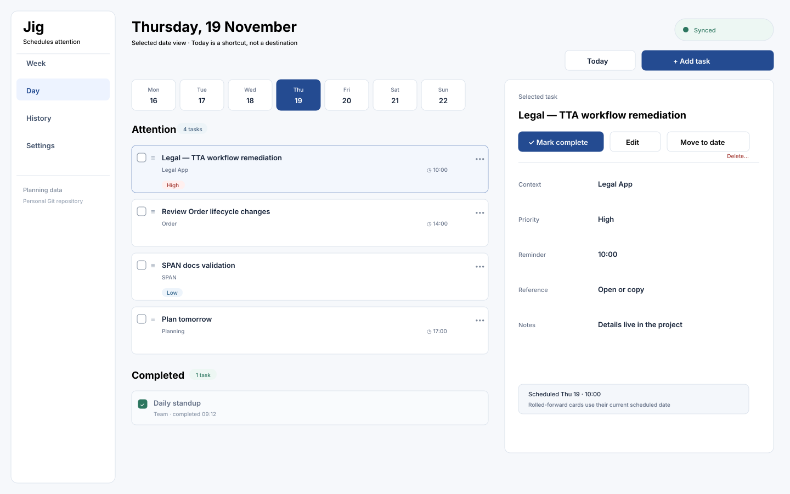
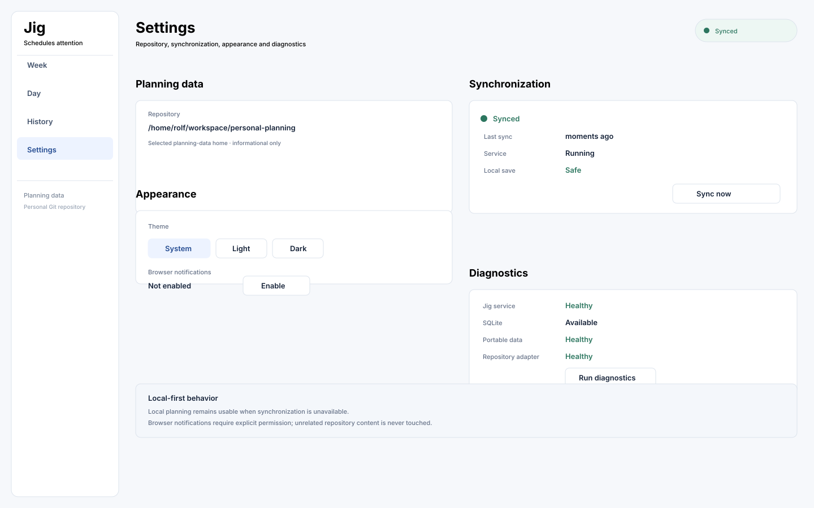

# Jig — UI solution design and visual reference contract

**Status:** Binding v1 UX/UI realization v0.4, 2026-11-16. Functional structure, Option A branding, Jig Light/Dark theming and browser evidence are governed.
**Governing behavior:** [Planning workbench functional design](../requirements/planning-workbench.md), JIG-FR-01–22.
**Technical foundation:** [Technical solution](../architecture/technical-solution.md), especially Astryx/dnd-kit ownership, service feedback and Git status. **Brand/theme authority:** [Brand and theme system](brand-and-theme.md).
**Purpose:** Turn the accepted early mobile/day/week/editor mockups into a versioned interface baseline while distinguishing layout intent from noncanonical visual decoration.

## 1. Source mockups and governed reference assets

The original design exploration used the temporary product name **Day**. It established the correct interaction direction: date-first weekly calendar/board, selected-day focus, compact title-first tasks, optional context/priority/reminder, drag handles, one task editor and a small completed region. The product's name is **Jig**.

The current repository includes seven **versioned SVG structural references**. The original four screens are corrected reconstructions of the approved Day-labelled layouts; History, Settings/Sync and save/sync failure states were added to close the Jig screen contract. Together these references govern structure, hierarchy, density and representative visual character. They are rendered in light mode for review and do not imply a light-only product or require duplicate dark-mode mockups.

| Governing artifact | Screen | Structural meaning |
|---|---|---|
|  | [Desktop weekly planner](reference/desktop-week.svg) | Primary seven-day scheduled-date board and visible cross-column movement targets |
|  | [Desktop day view](reference/desktop-day.svg) | Selected-date attention list with carried-over earlier work, completed group and selected task details |
|  | [Desktop history](reference/desktop-history.svg) | Lightweight completion history grouped by actual completion date |
|  | [Desktop settings/sync](reference/desktop-settings-sync.svg) | Repository, service, appearance and synchronization controls |
|  | [Mobile narrow day](reference/mobile-day.svg) | Compact date strip and one attention list at narrow widths |
|  | [Mobile edit surface](reference/mobile-editor.svg) | One bounded task editor with explicit Save/Cancel and destructive Delete for an existing Task |
|  | [Save/sync states](reference/sync-failure-states.svg) | Honest local-save and Git synchronization state/failure presentation |

### Original screenshot provenance

The original raster files inspected when this design was authored were:

| Original filename | SHA-256 | Screen mapping |
|---|---|---|
| `day_by_pontivus_weekly_planner.png` | `f7ec8d8a105fa232d21958a74c58df36061b043fe3cd62469ec0ed9f486a7119` | desktop-week |
| `day_planning_dashboard_jan_23.png` | `086dc27cda6b89e5db1a62ed582da316c373dbfb7177de932ee32c414d01ef7f` | desktop-day |
| `day_by_pontivus_planner.png` | `d0a9e2d0316dc950d44cf03220006676995213087a415f72af138b037ea8a270` | mobile-day |
| `day_task_editor_mockup.png` | `d1bbaaedd185060673f4bff146585d17b92e17d6a49745fef958ca9bf04e5ea1` | mobile-editor |

The original PNG bytes are **not** yet stored in the repository; their hashes and corresponding governed SVG reconstructions are recorded here so the sources can be verified and imported later if desired. Do not substitute an unrelated stock image or relabel the originals as Jig production screenshots. The versioned SVG files define the current reviewed **structural** baseline; pixel-perfect final rendering must be certified from the running Astryx UI.

## 2. Information architecture

The initial desktop IA has exactly **Week**, **Day**, **History**, and **Settings** as meaningful destinations. **Today** is a shortcut that selects the current local civil date within Day, not a separate destination. A separate **Board** destination is redundant: Week already is the dated Kanban board. The original mockups' Plan/Day/Board duplicates are not required screens.

- **Week** is the principal weekly planning/rearrangement surface: Monday–Sunday buckets, current/selected date emphasis, per-day ordered outstanding tasks, quick-add scoped to each date and cross-day drop targets. Long days scroll without losing date headings.
- **Day** is the default operational entry surface, initially selecting the current local civil date. It shows one canonical outstanding sequence for that date after daily rollover, then a compact Completed group and on-demand task detail. The Today shortcut selects the current local civil date; changing selection itself never reschedules tasks.
- **History** is a lightweight dated list grouped by actual completion date, not a dashboard. Each completed row shows the Task's canonical scheduled date at completion plus actual completion time, and has an explicit open/actions affordance so the same Task can be reopened or permanently deleted after confirmation.
- **Settings** exposes theme, browser-notification permission/support state, configured repository path as read-only context, coarse synchronization state/action, service health, local database health, portable-data/repository-adapter health and diagnostics. It does not expose repository migration, remote-name configuration, branch/ref/worktree state, Git history/merge/conflict workflows, or developer tooling.
- **No separately persisted boards, projects or queues.** Context is a short optional Task label and may be displayed or used as a filter, not an independent domain.

### Onboarding and installed lifecycle

The app's very first interaction is the **one-script installer** described in [Technical solution §3.1](../architecture/technical-solution.md). The script selects and validates the personal Git repository and configures the `jig` command + local background service. The user then opens the existing service with `jig` and immediately reaches Day on the current local civil date; Week remains one navigation action away. There is **no repeated onboarding wizard on every run**.

A compact, always-available status control must truthfully distinguish:
- **Saved locally / Synced:** latest local edits are committed to SQLite and the repository integration boundary reports the latest exported snapshot synchronized.
- **Sync pending / Retrying:** local data is safe; export or repository synchronization is still outstanding.
- **Local only:** no remote is configured; local DB and local Jig repository records continue normally.
- **Sync issue:** repository synchronization cannot currently complete, but successful local Task saves remain safe.

The UI does **not** classify the cause as divergence, merge conflict, branch state or another Git-topology concept, and it provides no Jig conflict-resolution workflow. Diagnostics may expose the underlying repository-adapter error for troubleshooting, but repository reconciliation happens with external Git tooling. The UI must not present an ordinary local edit as synchronized until the repository boundary reports success. A failed local save is a different, workflow-critical state and is displayed near the edited Task.

## 3. Visual language

Use the published **Astryx 0.7.13 core** with Jig's canonical theme defined by [Brand and theme system](brand-and-theme.md). `jigTheme` extends Astryx Neutral so Astryx continues to own spacing, typography mechanics, component structure and semantic status families, while Jig owns the product palette and its Light/Dark role mapping.

Theme ownership is singular:

- `ui/src/theme.css` owns raw Jig Ink/Amber/Paper primitives;
- `ui/src/theme.ts` maps those primitives to public Astryx semantic roles;
- `ui/src/styles.css` composes layout using semantic tokens and does not define a second palette;
- `ui/src/app.tsx` mounts the one root Jig Theme owner.

Visual rules:
1. **Compact, low-chrome and scan-oriented.** Prefer list/row structure with subtle boundaries to decorative card stacks; no gratuitous shadows/gradients.
2. **Dates and task titles first.** Priority is secondary: default Normal requires no loud badge; High/Low remain explicit but restrained. Reminders are labeled with a time and are not mistaken for event/time allocations.
3. **One primary action per active surface.** Quick Add is prominent at week level. A task detail editor has a single Save control. Completion uses an independently accessible checkbox/command.
4. **Clear current date and visible focus.** Selection/current, hover, focus, and save status remain semantically distinguishable without color alone.
5. **Brand restraint.** Ink and Paper own structure/surfaces; Amber is selective identity/action/focus emphasis. Semantic info/success/warning/error remain Astryx status colors and are never replaced with brand Amber.
6. **Theme parity.** System/Light/Dark are mandatory. System follows the browser/platform preference and explicit Light/Dark overrides it locally. The same structure, hierarchy, spacing, focus, selection, priority, completion, save and sync semantics must remain clear in both themes without relying on color alone.
7. **Mobile-first semantics, desktop-first completeness.** Layout may recompose, but no Task value, selected date or pending form draft changes as a side effect of a breakpoint.
8. **Reference SVGs remain structural.** Their wording, geometry and density are reviewable, but the final production palette is the canonical Jig theme. No duplicate dark-mode structural mockup set is required.

## 4. Screen specifications

### 4.1 Desktop Week

Header: “Week of [date range]”, previous/next controls, Today shortcut, optional lightweight context filter, Quick Add. The week has seven calendar-date columns using stable local civil dates (Monday-start). Each date has title/date, outstanding count, ordered task rows, a date-specific Add task entry and a visible droppable region even when empty.

Task row: one completion control, title, optional context, exceptional priority marker, optional reminder time, drag handle, and a clear open/edit affordance; no fixed time slot, duration, status progression or nested subtask view. A current selected date is indicated in header and border; a selected Task can open editor/detail without changing its relative order.

Dnd-kit owns sortable IDs, pointer/touch sensors and drop targets; Astryx owns row appearance. A dragged Task moves to the **exact destination/date/position** where dropped, not a priority-based recalculation. Cancellation restores the prior view. Save failure restores/marks pending the committed order visibly.

The original mockup's additional Board link, excessive Normal badges, green cards and weekly progress metrics are **not MVP authority**; omit them unless separately designed after functional validation.

### 4.2 Desktop Day

A date strip permits switching selected days. The attention list shows the canonical outstanding sequence scheduled for the selected date after service-owned daily rollover. No derived carry-over prefix or originating-date badge is rendered. Completed is compact and separately expandable. An optional right-hand inspector shows the selected Task, title, context, priority, reminder, reference, note and actions to complete/reopen, edit, move date or Delete; Delete is destructive and requires confirmation before mutation.

Day view and Week view query the **same Task**; opening the inspector does not create a second editable Task object. Preserve position changes and reload state. Reminder delivery uses one browser-side eligibility calculation: visible page → Astryx toast; hidden/open page with granted browser notification permission → browser Notification. A reminder never becomes a work item.

### 4.3 Mobile narrow Day

Below the single application-owned **48rem / 768 CSS px** breakpoint, the week board becomes a horizontal seven-date strip plus one Day attention list. Preserve prominent title-first task cards, touch-sized checkbox and action targets, whole-card drag where supported and a non-drag move-to-date command. A persistent Quick Add target may move to the thumb-reachable region, but must not obscure the last item or reminder feedback.

Desktop MVP requires responsive semantic continuity and basic mobile-sized layout validation. It does **not** require installation as a self-contained phone app, native Git commands or background push notifications.

### 4.4 Mobile/editor composition

Task creation defaults to **title only** and the initiating date; no forced priority, reminder, time estimate or context. Editing uses one bounded Astryx Dialog/compatible responsive treatment with Title, Date, optional Context, optional Priority, optional Reminder Time, optional Reference and optional short Notes. Optional fields are initially subordinate; no advanced project form.

Use explicit Save/Cancel, persistent form errors on invalid data or server refusal, and preserve the active draft while the screen is reflowed or while a user inspects another date unless they explicitly confirm discarding edits. For an existing Task, expose a visually subordinate destructive **Delete task…** action; activating it opens an explicit confirmation and only confirmation invokes deletion. Creation mode has no Delete action. Date editing applies priority-guided insertion, whereas a drag drop uses the exact drop index. Changing priority does not rearrange the task.

## 5. Interaction and component ownership

| UI concern | Canonical owner |
|---|---|
| Shell, navigation, buttons, icon buttons, lists, labels, fields, dialog/drawer, calendar input, time input, toasts, semantic theme | Astryx published primitives |
| Sortable rows, drop zones, drag overlays, keyboard drag, pointer/touch gesture lifecycle | @dnd-kit/react only; do not activate Astryx List createReorderable on the same row |
| Week/date bucket composition, Day selected-date sequence, mobile strip, empty-date state, completed groups, task editor composition | Small Jig React composition |
| Scheduled date, ordering, daily rollover, initial priority placement, complete/reopen/delete, task identity | Pure Jig planning core |
| Task reads/writes and generic repository synchronization status | Bun service with SQLite plus isolated repository integration adapter |
| Reminder due eligibility and presentation while browser is open | One browser-side timer/eligibility monitor + Astryx useToast + browser Notification API; no background sender/service worker |

Keyboard alternatives **Move up**, **Move down**, **Move to date** invoke the same canonical Task operation as a drag. The drag handle must not swallow checkbox clicks, link navigation or editor opening. Avoid duplicate focus stops on the ListItem's clickable layer and nested controls; verify Astryx + dnd-kit with actual Playwright browser interaction.

## 6. Required browser/UX validation

| Case | Acceptance |
|---|---|
| Week scanning | Seven readable dates with distinct current/selected state and no horizontal overflow of individual task titles |
| Title-only creation | Adds into originating date in a minimum interaction |
| Priority default | Newly created task inserted by functional priority law, existing manual sequence untouched |
| Same-day drag | Exact chosen position persists after reload |
| Cross-day drag | Destination and position persist, source loses item, empty date works |
| Midday edits | Metadata/priority edits preserve manual ordering |
| Completion | Task leaves active list, keeps scheduled date and actual completion time/history |
| Daily rollover | Earlier unfinished Task is automatically moved into the current local date by changing `scheduled_date`; the same moved card appears in the current bucket in Week and Day |
| Delete | Cancelled confirmation makes no mutation; confirmed deletion removes outstanding/completed Task from all current views and remains deleted after reload/Git round trip |
| Responsive reflow | No loss of selected date, task, open editor draft or outstanding modifications |
| Keyboard and touch | No hover-only essential actions; non-drag alternatives and visible focus |
| Reminder | Visible page => one dismissible toast; hidden/open + granted permission => one browser Notification; permission requested only by explicit user action; no claim when browser closed |
| Local save failure | User sees specific unresolved error, not fake save success |
| Auto-sync lifecycle | Service can save/sync with browser closed; header/settings convey local/synced/pending/local-only/sync-issue truth without Git divergence/conflict semantics |
| Offline use | Editing remains available, Git retries later without blocking |
| Theme parity | System/Light/Dark are all supported; representative Week, Day, editor, Settings and error/status states retain equivalent hierarchy, contrast and non-color semantics in Light and Dark |
| Resource discipline | Responsive reopen and low-idle service measured as part of installer certification |

Use actual approved Astryx and dnd-kit versions in Playwright for final UI evidence; these SVGs alone do not certify pixel fidelity or interaction. Archive browser screenshots from these tests in the repository when implementation begins; they supersede early concept art only after review.

## 7. Design change control

The seven versioned SVGs in `docs/design/reference/` remain the structural baseline for layout, interaction hierarchy and density. Production color, logo use and Light/Dark behavior are governed centrally by [Brand and theme system](brand-and-theme.md); no duplicate dark structural SVG set is required. When an interaction changes, update this document and the relevant SVG together. If only runtime appearance changes to correct Astryx component parity, update implementation and browser evidence without inventing a second canonical visual-token contract.

Do not refer to the previous Day branding as a current product identity. Do not use project-specific task details as content that Jig must store; they exist only as illustrative samples. An implementation plan must link to this document and to [Technical solution](../architecture/technical-solution.md).
